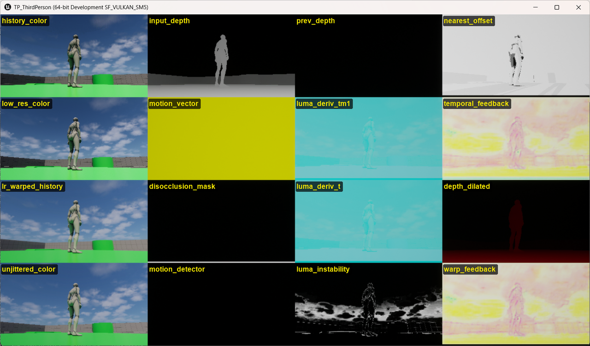
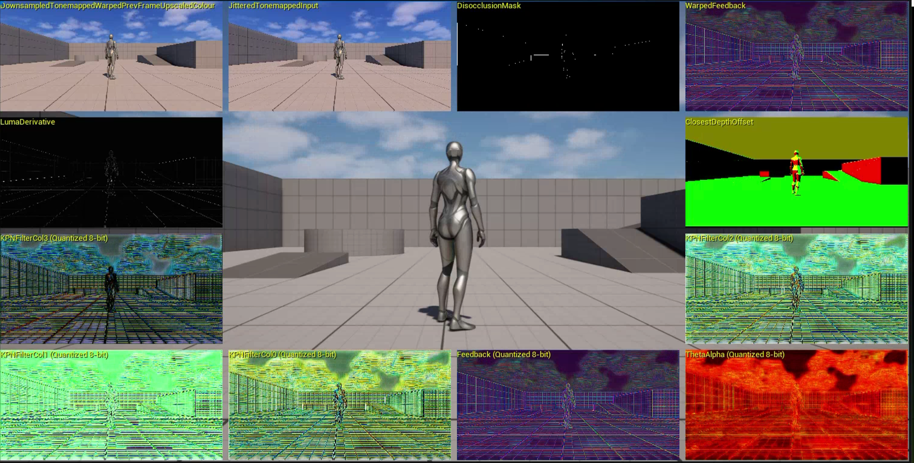

## Start the level and verify NSS

To test NSS in Unreal Engine 5.6:

1. Open **Edit > Project Settings > Plugins > Neural Graphics 1.1.1** and select **Enable** under **NSS**. This sets `r.NSS.Enable` to `1` for the game; the default is `0`.
2. Select **Play** to start Play In Editor, or open the **Play** menu and select **Standalone Game**.
3. In the active editor or game console, verify NSS with:

   ```console
   ShowFlag.VisualizeTemporalUpscaler 1
   ```

   Confirm that **ThirdParty TemporalUpscaler** reports **NSS** in the rendering summary.

Run `ShowFlag.VisualizeTemporalUpscaler 0` to disable the overview. To visualize the NSS model output in real-time, run the following command:
   ```console
   r.NSS.Debug 1
   ```

The screenshot was captured in Standalone Game. Play In Editor also displays the same 16 labeled outputs, including history color, depth, motion vectors, and temporal feedback. See [Wrapping up](/learning-paths/mobile-graphics-and-gaming/nss-unreal/6-wrapping-up/) for more about these outputs.



## NSS console variables

The following table describes Arm Neural Graphics Plugin 1.1.1 for Unreal Engine 5.4 and 5.6. Unreal Engine 4.27 uses a [separate plugin branch](https://github.com/arm/neural-graphics-for-unreal/tree/ue4.27) with the older Neural Graphics SDK v1.0.1.

Use these Unreal Engine console variables to configure NSS behavior, debug views, and resource lifetime. Enter a variable and value in the Unreal Engine console, for example, `r.NSS.Enable 1`.

| Console variable | Default | Value range | Details |
|------------------|---------|-------------|---------|
| `r.NSS.Enable` | `0` | `0`, `1` | Enables NSS for Temporal Upscale. |
| `r.NSS.EnableInEditorViewport` | `0` | `0`, `1` | Enables NSS in the non-playing editor viewport. Play In Editor does not need this setting. |
| `r.NSS.Debug` | `0` | `0`, `1` | Displays 16 debug outputs in a 4×4 grid. |
| `r.NSS.DebugViewMode` | `0` | `0`–`16` | With `r.NSS.Debug 1`, `0` shows all 16 tiles and `1`–`16` shows one tile full screen. |
| `r.NSS.AdjustMipBias` | `1` | Read-only | Allows NSS to adjust the minimum global texture mip bias: `r.ViewTextureMipBias.Min` and `r.ViewTextureMipBias.Offset`. |
| `r.NSS.ShaderQualityMode` | `1` | `0`, `1`, `2` | Selects shader quality: `0` for quality (high), `1` for balanced (default), and `2` for performance (low). |
| `r.NSS.UseFragmentShader` | `1` | `0`, `1` | Uses a fragment job for NSS. |
| `r.NG.DeferDelete` | `5` | `> 0` | Sets the number of frames to defer deletion. |

For Unreal Engine 4.27, run `r.NSS.Enable 1`, then `r.NSS.Debug 1`. This version displays 12 debug output tiles around a larger central game image. If NSS does not appear, check `r.TemporalAA.Upscaler 1` and `r.TemporalAA.Upsampling 1`, as described in the [UE 4.27 plugin README](https://github.com/arm/neural-graphics-for-unreal/tree/ue4.27).



## Troubleshooting tips

If the example does not behave as expected, check the following common issues before continuing.

### Plugin missing or build failed

If the plugin is missing, first check that `NG.uplugin` is directly inside your engine-specific plugin folder. If the build failed, first inspect the earliest error for your project's editor target in Visual Studio's **Output > Build**. Follow the [plugin setup and build checks](/learning-paths/mobile-graphics-and-gaming/nss-unreal/3-create-example/#enable-the-plugin).

### NSS absent from the rendering summary
- First query `r.NSS.Enable` without a value and confirm that it reports `1`.
- Verify that Vulkan is selected as the **Default RHI**.
- Confirm the **Arm Neural Graphics Plugin** is enabled and that Unreal Engine was restarted after enabling it.
- Check **Edit > Project Settings > Plugins > Neural Graphics 1.1.1** to confirm that NSS is enabled.

If the Arm Neural Graphics Plugin is enabled but NSS appears to have no effect:
- Confirm that you installed the ML Emulation Layer for Vulkan downloaded by `DownloadEmulationLayer.bat`.
- Ensure Vulkan Configurator is running.
- Verify that the correct layer configuration is selected and active.
- Double-check that:
  - The emulation layer path points to the plugin's `Binaries\ThirdParty\VulkanMLEmulation\Win64` directory
  - The Graph layer is ordered above the Tensor layer

Refer back to the [emulation layer section](/learning-paths/mobile-graphics-and-gaming/nss-unreal/2-emulation-layer/) for the full Vulkan Configurator setup and validation steps.

### Debug view absent

First confirm that `ShowFlag.VisualizeTemporalUpscaler 1` reports NSS while the game is running. Then hide the overview and run `r.NSS.Debug 1` again. Use Play In Editor or Standalone Game for this check. NSS is disabled in the non-playing editor viewport by default.

### Check the software and hardware setup
- Confirm that you're using the plugin version listed in the setup instructions with a supported Unreal Engine version.
- Verify that your GPU driver supports Vulkan.
- Verify that your Visual Studio version aligns with the Unreal Engine version you are using.
- Return to the Visual Studio build output and inspect the logs carefully to identify the first reported error

Build or startup failures are often caused by version mismatches or missing dependencies.

## NSS model on Hugging Face

The model that powers NSS is published on Hugging Face in the [VGF format](https://github.com/arm/ai-ml-sdk-vgf-library). This format is optimized for inference via ML extensions for Vulkan.

Visit the [NSS model page on Hugging Face](https://huggingface.co/Arm/neural-super-sampling/)

On this landing page, you can read more about the model, and learn how to run a test case - a _scenario_ - using the ML SDK for Vulkan.

## Result

You now have Neural Super Sampling integrated and running inside Unreal Engine. This setup provides a real-time testbed for neural upscaling.

Proceed to the next section to debug your frames using RenderDoc, or move on to the final section to explore more resources on the technology behind NSS.
