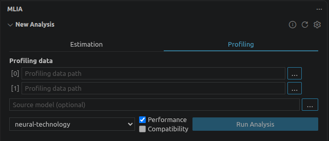

## Understand the NX profiling workflow

The MLIA for VS Code extension lets you analyze model performance within your editor. It runs Arm ML Inference Advisor (MLIA) and presents the results in Model Explorer.

You'll run a small neural upscaler on an Android device with an Arm neural accelerator (NX) and capture its execution. Then you'll use the extension to inspect measured performance and trace costly parts of the model back to Python source.

To check model compatibility and estimate NX performance before running on a device, see the [NX performance estimation Learning Path](/learning-paths/mobile-graphics-and-gaming/mlia-nx-performance-estimator/). It introduces the MLIA command-line workflow and compares model variants without requiring NX hardware.

The workflow has three parts:

| Stage | Tool | Result |
| --- | --- | --- |
| Execute and capture | Scenario Runner and the Neural Statistics Vulkan layer on Android | A directory containing capture metadata and driver statistics |
| Analyze | MLIA for VS Code extension on your Linux host | A saved profiling analysis with measured performance results |
| Investigate | Model Explorer and the source editor within VS Code | Graph overlays, source navigation, heatmaps, and CodeLens |

The exercise uses one dispatch and zero-filled input to establish the capture and analysis workflow. It doesn't measure application frame time, establish sustained performance, or validate the upscaler's image quality.

Allow about 90 minutes after preparing the prerequisite model and host tools. This provisional estimate includes preparing Scenario Runner and collecting and analyzing a capture; allow extra time for installation and downloads.

{}
Device capture, measured graph metrics, and Python source navigation have been validated. Numeric source-line heatmaps and CodeLens values still need confirmation with the author before publication.
{}

## Prepare a compatible VGF export

MLIA needs VGF 0.4.3 from Model Converter v0.10.0, as specified in the extension's [VGF preparation guide](https://github.com/arm/vscode-mlia/blob/main/docs/users/creating-vgf-model.md). Use ExecuTorch v1.5.1, which selects that converter.

In a new project directory, create an export environment with the released CPU packages. These packages include the VGF export dependencies, so you can prepare this example without building ExecuTorch from source:

```bash
python3.12 -m venv export-venv
source export-venv/bin/activate
python -m pip install \
    'executorch[vgf]==1.5.1' \
    'torch==2.14.0+cpu' \
    'torchvision==0.29.0+cpu' \
    --extra-index-url https://download.pytorch.org/whl/cpu
```

Keep this environment active so that the installed Model Converter is on `PATH`. If you build Scenario Runner, use a separate SDK build environment.

Save the complete `SmallUpscalerModel` post-training quantization (PTQ) example from [Quantize neural upscaling models with ExecuTorch](/learning-paths/mobile-graphics-and-gaming/quantize-neural-upscaling-models/3-run-ptq-and-export-vgf/#run-the-end-to-end-ptq-example) as `quantize_and_export_vgf.py` in this directory. Use the environment above and run only that example:

```bash
python quantize_and_export_vgf.py
```

The script downloads CIFAR-10, trains the small model for one epoch, calibrates it, and exports a VGF under `output/`. If you already exported with a different toolchain, prepare a fresh environment with these versions and rerun the example; installing new tools does not update an existing VGF.

Retain both debug options already present in the PTQ example:

- `compiler_flags=["--emit-debug-info"]` in `VgfCompileSpec` embeds ExecuTorch stack traces and module metadata.
- `.dump_debug_info(VgfCompileSpec.DebugMode.TOSA)` preserves the corresponding TOSA debug information during lowering.

Keep the Python file that produced the export unchanged. Source navigation needs its original contents and line numbers; moving the file can require path remapping.

## Create a profiling workspace

Open the directory containing `quantize_and_export_vgf.py` in VS Code using **File > Open Folder**. Open **Terminal > New Terminal** and use Bash for the remaining commands.

From that project directory, list the exported VGF files:

```bash
find output -type f -name '*.vgf'
```

Use the VGF from this PTQ export, typically `output/output_tag0.tosa.vgf`. If you find several artifacts, check that `output/` contains only the current example's export. If a fresh export still produces several partitions, stop and check the pinned versions and unchanged example before proceeding. This walkthrough profiles one VGF, and its totals describe only the graph contained in that file.

For the unchanged example, set the exported model path and check that it contains data:

```bash
export NX_WORKSPACE="$PWD/nx-profile"
export MODEL_VGF="$PWD/output/output_tag0.tosa.vgf"
test -s "$MODEL_VGF"
```

Continue only if `test -s` succeeds. Copy the model to a stable workload path:

```bash
mkdir -p "$NX_WORKSPACE/workload" "$NX_WORKSPACE/captures"
cp "$MODEL_VGF" "$NX_WORKSPACE/workload/model.vgf"
cd "$NX_WORKSPACE"
```

Keep this terminal open across the capture pages. `NX_WORKSPACE` identifies the host working directory; leave the original Python source in the project directory.

## Prepare the extension's managed environment

Follow the [MLIA extension installation instructions](https://github.com/arm/vscode-mlia/blob/main/docs/users/installation.md). This walkthrough was tested with extension v0.1.1. If you use a release VSIX, install it with **Extensions > ... > Install from VSIX...**.

In VS Code:

1. Select **MLIA** in the Activity Bar.
2. In **New Analysis**, select **Refresh MLIA Environment** and wait for setup to finish.

    
    <span class="content-image-caption centered">Initialize the managed MLIA environment</span>

3. Select **Profiling** and confirm that the `neural-technology` target profile is available.

    

The extension manages its own Python and MLIA installation, separately from your model-export and SDK build environments. You don't need a command-line MLIA installation.

If setup fails or the profile is absent, select **Show Log** and resolve the environment error before proceeding. See the extension's [environment troubleshooting guide](https://github.com/arm/vscode-mlia/blob/main/docs/users/troubleshooting.md).

## What you've accomplished and what's next

You've prepared a debug-enabled VGF, retained the source that produced it, and initialized MLIA in VS Code. Next, you'll prepare Scenario Runner and generate the Android workload for this exact artifact.
