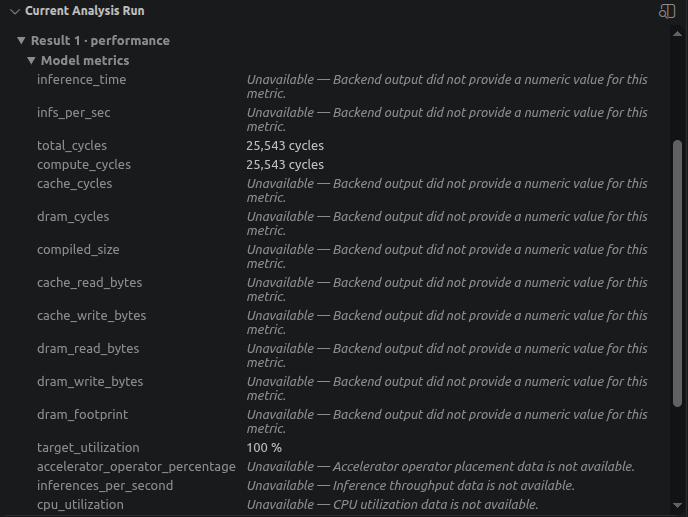
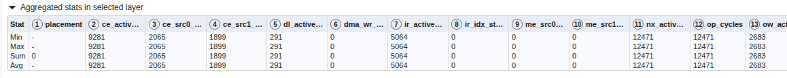
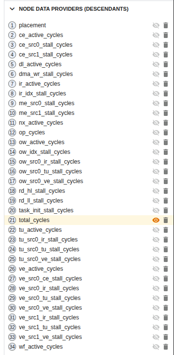

## Select the capture and matching model

Return to the VS Code window containing your Python model project. The device can remain disconnected during analysis because the capture is now on the host.

Print the two input paths from the capture terminal:

```bash
printf 'Profiling data: %s\nSource model: %s\n' "$CAPTURE_ROOT" "$NX_WORKSPACE/workload/model.vgf"
```

Select the same `model.vgf` used to collect the capture. Don't overwrite it with a new export before analysis.

In **MLIA > New Analysis**:

1. Select **Profiling**.
2. Add the printed **Profiling data** directory. Select the directory directly containing `capture.json`, not `capture.tar`, the enclosing `captures` directory, or an individual `.bin` file.
3. Select `nx-profile/workload/model.vgf` in **Source model**. This matching VGF supplies the graph and Python source mappings.
4. Select `neural-technology` as the target profile.
5. Enable **Performance**.
6. Select **Run Analysis**.

<!-- Publication: add a screenshot from this walkthrough showing Profiling, its capture root, model.vgf, neural-technology, and Performance. -->


Model Explorer opens with a loading view while MLIA analyzes the capture. Wait for completion before inspecting the metrics.

## Verify that the result uses measurements

In **Current Analysis Run**, confirm that:

- The run completed successfully.
- **Mode** is **Profiling** and **Checks** includes **Performance**.
- The profiling-data directory and source model match the inputs you selected.
- The target profile is `neural-technology`.
- A performance result is available under **Model metrics**.

The selected entry in **Analysis Runs** determines which analysis you're inspecting. **Current Analysis Run** shows its configuration and **Model metrics** for the selected VGF. Model Explorer displays its graphs and details for the selected node or group in its side panel. Keep this profiling run selected as you explore its results.

Select **Open Analysis Run Folder** on the completed entry in **Analysis Runs**, then open `mlia-output/model-explorer/standardized-output.json`. Within its `results` array, find the object whose `kind` is `performance`. Confirm these fields; the excerpt omits the other result fields:

```json
{
    "kind": "performance",
    "status": "ok",
    "mode": "measured"
}
```

The `measured` mode confirms that the result uses capture data.

If the run fails, inspect its error summary and the **MLIA** output log, then check the inputs:

| Problem | Action |
| --- | --- |
| Missing or invalid capture files | Recheck `capture.json`, its completion status, and the complete extracted directory tree. |
| Model and captured pipelines don't match | Select the exact VGF deployed to the device. If you exported a new VGF, collect a matching capture before analyzing it. |
| Capture selection is ambiguous | Recreate this example with one scenario execution and dispatch filter `0`; consult the profiling documentation before combining captures. |
| No profiling target profile is available | Refresh the managed MLIA environment and inspect its setup log. |

## Read the model-level metrics first

Expand the performance result's **Model metrics** and find `total_cycles`, with unit `cycles`. It summarizes the cycle cost attributed to the captured VGF. The mode-1 profiling backend derives both `total_cycles` and `compute_cycles` from the reported NX-active cycle counts.

These counts describe accelerator work for the captured dispatch, excluding application work such as CPU preprocessing and presentation. They are not elapsed application latency. Use representative inputs and repeated measurements before drawing application-performance conclusions.

The screenshot shows an illustrative model total of 25,543 cycles. Your value can differ with the exported model, driver, and device. Record your model's `total_cycles` before exploring the graph, and read the explanations for unavailable metrics.

<!-- TODO (Ann, author confirmation): Confirm that mode 1 derives target_utilization as compute_cycles / total_cycles * 100, with both using the same NX-active counters. Confirm the wording below with Matthew before publication. -->

In this mode-1 result, `total_cycles` and `compute_cycles` use the same NX-active counts, so `target_utilization` displays 100%. This ratio does not independently measure accelerator occupancy over application execution. Use the reported cycle costs for this exercise. See the [Neural Technology metrics reference](https://github.com/arm/mlia-neural-technology/blob/main/docs/source/outputs_metrics.md) for the counter aggregation rules.



## Explore the model graph

In Model Explorer, select **Source Model** in the graph selector to inspect the original VGF graph. Use the navigation controls to find your way around the model:

1. Select **Fit to screen** on the toolbar, or press **Space** while the graph has focus, to show the whole graph.
2. Drag the graph to pan.
3. Use a group's expand control to reveal its contents. Collapse it when you want to return to a broader view.
4. Use the search box to find a node by name. Select a result to locate it in the graph, then inspect its attributes, inputs, and outputs in the side panel.

Next, select **segment_cascade_chain**. It groups operations into the segments, cascades, and chains used for hardware execution. Expand a segment to its cascades and chains to inspect increasingly specific execution groups.

The [Model Explorer representation guide](https://github.com/arm/vscode-mlia/blob/main/docs/users/model-explorer-representations.md) explains the views available for different model metadata and results.

## Compare measured values within a cascade

In the screenshot, `Cascade 249` is darker green than the other cascades because its reported cycle count is higher. Selecting it shows 12,471 cycles for the combined `CONV2D` and `RESCALE` work and highlights the corresponding operations in **Source Model**. Your group identifiers and values can differ; select a group with a measured value in your own result.

When an operation has an accessible source mapping, you can navigate to its Python source. The next page explains source navigation and the availability of source-line cycle values.


## Inspect group statistics and change the overlay

With the group selected, inspect **Aggregated stats in selected layer**. The table summarizes available numeric node values within that group, separately for each data-provider run. Minimum and maximum show their range; sum and average summarize those node values. The table can be useful for a single captured execution containing several valued nodes. If only one node has a numeric value, minimum, maximum, sum, and average can all be equal.



In **Node data providers (descendants)**, select the eye icon beside a metric to display its overlay on the graph. In this example, `total_cycles` is selected by default.



## Choose a group to investigate

Choose a group with a higher reported cycle cost than a comparable group in the same view, like in the sample above. Record the comparison that makes it worth investigating. If only one group has a value, record that limitation and use it to practice source tracing without claiming it is the dominant cost.

Before moving to the Python source, record:

- The graph representation and group name.
- The selected measured cycle metric, its value, and its unit.
- The model-level metric and value you recorded earlier, keeping its scope distinct from the group's value.

Keep that group and cycle overlay selected for the next page. A high reported cost identifies a candidate to inspect; it does not establish that changing the operation will improve application performance.

## What you've accomplished and what's next

You've run a measured profiling analysis, checked its origin, and inspected model totals. You've also explored the graph, compared mapped values and group statistics, and chosen an execution group to investigate. Next, you'll connect that evidence to the Python source that produced the graph.
