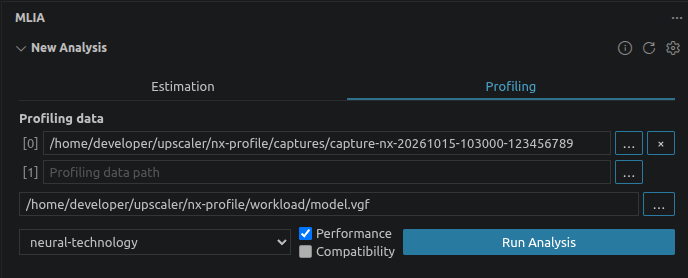
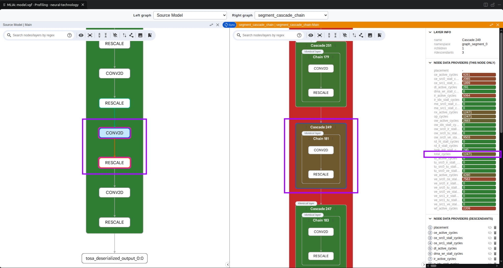

## Select the capture and matching model

Return to the VS Code window containing your Python model project. Print the Scenario Runner capture and model paths from the capture terminal:

```bash
printf 'Profiling data: %s\nSource model: %s\n' "$CAPTURE_ROOT" "$NX_WORKSPACE/workload/model.vgf"
```

For an existing-application capture, use its capture directory and matching VGF instead.

In **MLIA > New Analysis**:

1. Select **Profiling**.
2. Add the printed **Profiling data** directory, which directly contains `capture.json`.
3. Select `nx-profile/workload/model.vgf` in **Source model**. Use the same VGF deployed to the device.
4. Select `neural-technology` as the target profile.
5. Enable **Performance**.
6. Select **Run Analysis**.



Model Explorer opens when the analysis completes. For analysis errors, see the [MLIA analysis troubleshooting guide](https://github.com/arm/vscode-mlia/blob/main/docs/users/troubleshooting.md#an-analysis-fails).

## Inspect a cascade's cycle cost

In Model Explorer, set **Left graph** to **Source Model** and **Right graph** to **segment_cascade_chain**. The latter groups operations into the segments, cascades, and chains used for hardware execution. Expand a segment to see its cascades.

The `total_cycles` overlay is selected by default. It shows accelerator cycle counts for the captured dispatch, not application latency.

Select a cascade with a reported cycle value. In the example screenshot, `Cascade 249` has 12,471 cycles for its combined `CONV2D` and `RESCALE` work. Selecting it highlights the corresponding operations in **Source Model**. Identifiers and cycle counts can differ between exports and devices.



Keep the cascade selected for the next page. For other graph views, see the [MLIA Model Explorer representation guide](https://github.com/arm/vscode-mlia/blob/main/docs/users/model-explorer-representations.md).

## What you've accomplished and what's next

You've inspected a cascade's measured cycle cost. Next, follow one of its operations to Python source.
