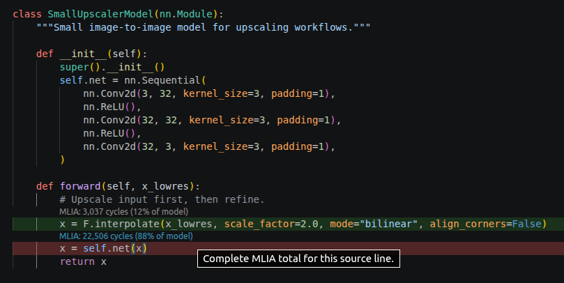
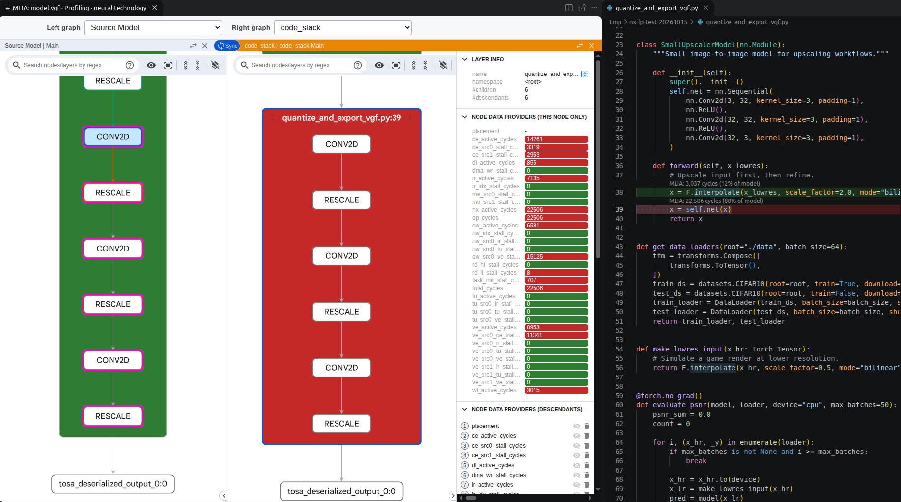

## Check that the source locations are available

Keep the completed profiling run selected in **Analysis Runs**. Expand its performance result's **Source mappings** in **Current Analysis Run**.

Expand **Accessible locally**, find `quantize_and_export_vgf.py`, and select a reported line to open the source that produced your VGF.

If no source locations are reported, return to the model export and check both debug settings. A path mapping can't recreate metadata omitted during export. If you re-export the VGF, generate a new scenario and collect a matching capture before repeating the analysis.

If locations exist but your Python file is inaccessible, [resolve its moved path](#optional-resolve-moved-source-files), then return here. Missing framework files need not block navigation to your model, but you need at least one accessible, mapped model-source location to complete the exercise.

## Follow a costly group into the Python model

Selecting a mapped node in **segment_cascade_chain** or **Source Model** automatically opens the corresponding Python file and highlights its source line. **Sync Model Explorer Selection To Code** enables this behavior and is on by default.

Use the group you chose on the previous page:

1. Keep the measured cycle overlay selected in Model Explorer.
2. Expand the costly group and select an operation node in **segment_cascade_chain** or **Source Model**.
3. VS Code opens your model's Python source and highlights the mapped line. Inspect that code alongside the node's measured value.

You can also explore **nn_module** and **code_stack** when available to see the module hierarchy and source call stacks. Selecting a mapped node in these views uses the same automatic navigation.

If selecting a node doesn't open the source, check `vscode-mlia.syncModelExplorerSelectionToCode` in VS Code **Settings** and confirm that the file appears under **Accessible locally**. A node needs one unambiguous local file and line. If a group maps to several locations, expand it and select an individual operation, or inspect the locations in **Source mappings**.

## Read source heatmaps and CodeLens

<!-- TODO (Ann, author confirmation): Ask Matthew for the exact model artifact, exporter/driver versions, extension and MLIA versions, and any extra settings used for the numeric heatmap and 88%/12% screenshots. With the unchanged PTQ example, ExecuTorch 1.5.1 / converter 0.10.0, extension 0.1.1, MLIA 0.12.3 and mlia-neural-technology 0.2.1, capture and graph metrics passed, but both Python lines showed "total cycles unavailable". Revalidate the steps and screenshots below with his confirmed setup before publication; confirm whether a matching model/source/scenario bundle can be supplied. -->

With your model source open, select the measured cycle overlay in **Current Analysis Run**. Source navigation and numeric attribution are separate checks: an accessible mapped line can still have no reported cycle value.

If CodeLens reports **total cycles unavailable**, read its hover explanation. During technical review, both model lines reported missing cycle data even though the capture, measured graph metrics, and source navigation succeeded. You can still inspect the measured group in Model Explorer and follow its source mapping. Don't assign part of a group's cycles to a Python line without a reported numeric mapping.

When numeric source values are available, inspect their presentation:

- Numeric heatmap colours show relative values across mapped lines. They help locate regions to inspect.
- CodeLens displays the selected value and, when it can be calculated safely, its percentage of the model total.
- Selecting a metric CodeLens entry selects its associated node in Model Explorer.

Follow a CodeLens entry back to the graph and confirm that the same overlay remains selected. Several source lines can refer to shared execution work, so their values are not additive model totals.

In the author's screenshot, CodeLens maps 22,506 cycles to `x = self.net(x)`, approximately 88% of the captured model's total cycles. This line calls the `nn.Sequential` block defined in `SmallUpscalerModel`. These values illustrate numeric source attribution; they are not expected values for every export or capture.



When a numeric CodeLens entry is available, select it to locate its associated graph nodes. The screenshot shows `MLIA: 22,506 cycles (88% of model)` selected, with corresponding **Source Model** operations on the left and the line's operations in **code_stack** on the right.



If source presentation is missing, check these settings and inputs:

| Check | Expected state |
| --- | --- |
| Current run | The completed profiling analysis is selected. |
| Overlay | A measured metric is selected rather than **None**. |
| Source file | The matching file appears under **Accessible locally** and is open in the editor. |
| `vscode-mlia.showHeatmap` | Enabled. |
| `vscode-mlia.showCodeLens` and `editor.codeLens` | Both enabled. |
| Metric mapping | The selected overlay reports a value for that source location. |

For unavailable values, read the CodeLens hover explanation. The extension's [source visualization guide](https://github.com/arm/vscode-mlia/blob/main/docs/users/source-visualisation.md) explains the presentation controls.

## Optional: resolve moved source files

Use this section only if the embedded paths no longer resolve. In **Source mappings**, expand **Distinct source locations**, inspect the old paths, and select **Configure source file mapping**. This opens the setting in VS Code. To enter JSON, run **Preferences: Open Workspace Settings (JSON)** from the Command Palette.

If export embedded `/home/export/upscaler` and the unchanged project is now in `/home/developer/upscaler`, add this property, replacing both paths with yours:

```json
{
    "vscode-mlia.sourceFileMap": {
        "/home/export/upscaler": "/home/developer/upscaler"
    }
}
```

Merge the property into the existing settings object. The extension preserves the path suffix after the matched prefix and refreshes mappings automatically. Recheck **Accessible locally** and open a source line. Path remapping cannot correct changed source contents or line numbers. See the [source-file mapping guide](https://github.com/arm/vscode-mlia/blob/main/docs/users/source-file-mapping.md) for more complex layouts.

## Optional: reopen a saved analysis

Close the analysis tab, then select the completed entry in **Analysis Runs**. Its graph views and saved overlay should reopen without another capture. Open the mapped source again to inspect its heatmap and CodeLens. The [analysis guide](https://github.com/arm/vscode-mlia/blob/main/docs/users/analyses.md) describes saved-run management.

## What you've accomplished

You've captured NX statistics for the selected VGF, analyzed its measured costs in VS Code, and traced a candidate through model graphs to Python source. Your next task is to establish a representative baseline before testing a model change.
