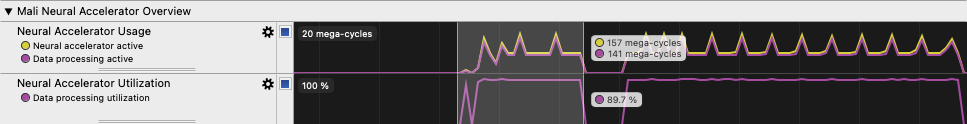
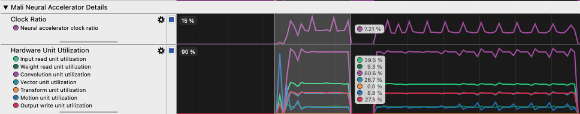
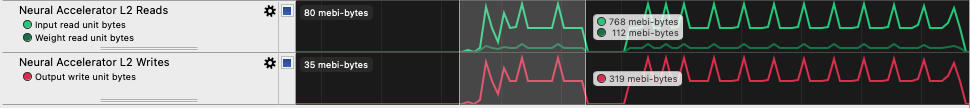
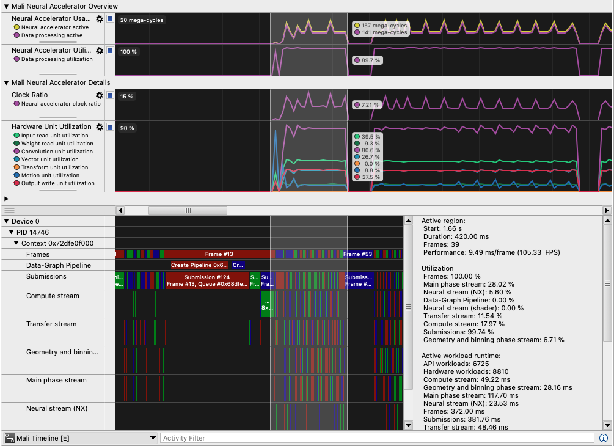
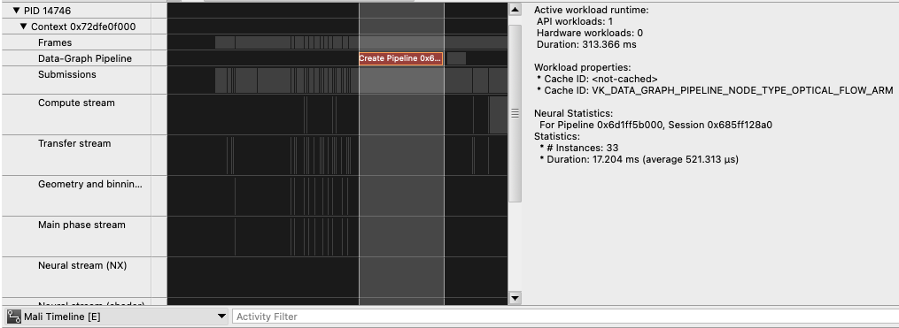
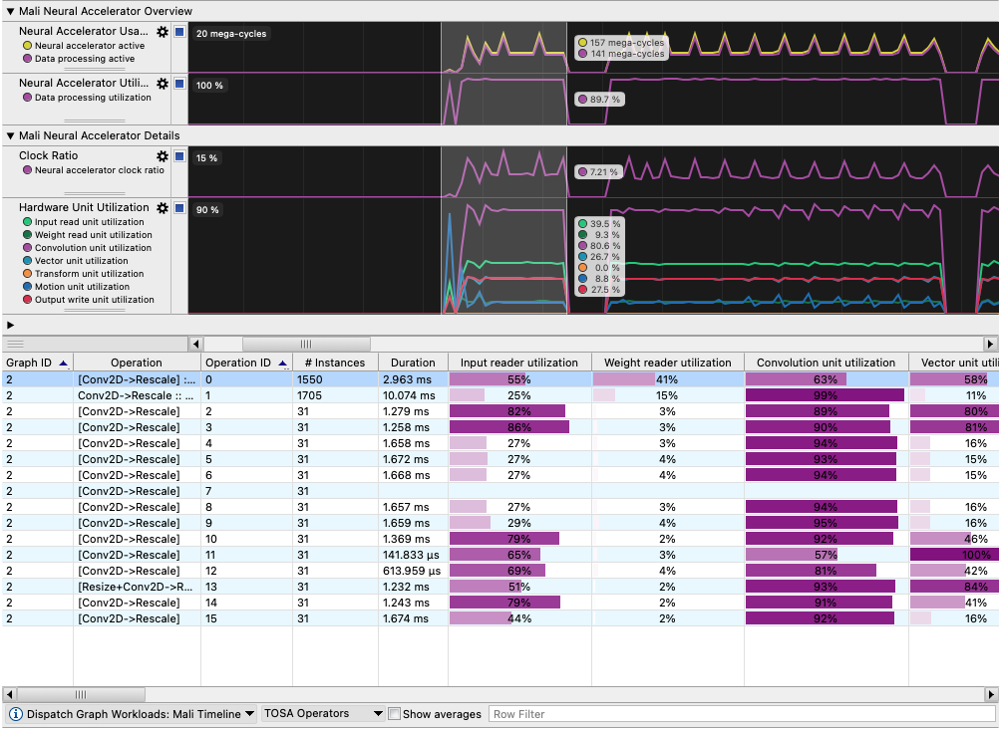

We will not cover all the information from a capture but focus on neural-related Timeline rows. Mali Timeline and Dispatch Graph Workloads connect these patterns to frames and operation costs. Performance engineers should also examine CPU scheduling, shader-core workloads and their opportunities for parallel execution, and traffic involving other GPU units.

Available rows depend on the counters collected and the chart template selected. See the [Mali G2 neural accelerator counter reference](https://arm-software.github.io/libGPUCounters/mali_g2_counter_reference.html#neural-accelerator) for metric definitions and the [Streamline ML for Vulkan analysis guide](https://support.arm.com/documentation/101816/9-9/Analyze-your-capture/Analyze-ML-for-Vulkan-workloads?lang=en) for workload analysis.

The examples below use the built-in **Mali G2-Ultra - 5th Generation** template selected during capture, not a custom raw-counter chart configuration. Select the **gear icon** beside a Timeline row to open its chart configuration. Each series has a **Description** field explaining what the counter measures. See the [Streamline 9.9 User Guide](https://support.arm.com/documentation/101816/9-9) for more about chart configuration.

## Mali Neural Accelerator Overview

Expand **Mali Neural Accelerator Overview** to see overall activity and processing utilization. Compare **Neural Accelerator Usage** with **Neural Accelerator Utilization** to investigate gaps between queued work and computation. The example shows 89.7% data processing utilization during accelerator-active cycles, rather than across the entire frame.

**Neural accelerator active** counts cycles with work queued, while **Data processing active** counts cycles when at least one processing unit performs computation. These overlap, so do not add them. In the illustrated **Accumulate** chart, mega-cycles are millions of cycles within a displayed time bin, not the capture's total duration. Converting cycles to time requires the relevant clock frequency.



## Mali Neural Accelerator Details

Expand **Mali Neural Accelerator Details** to compare individual hardware-unit utilization over time. The example shows 80.6% convolution utilization, alongside lower reader and vector utilization. This highlights the convolution unit as a starting point for investigating operation costs. The **Clock Ratio** row estimates the neural accelerator clock relative to the top-level GPU clock.

Units can operate concurrently, so their utilization percentages are not additive. A busy unit alone does not establish a bottleneck; compare it with the duration and scheduling of the associated graph operations.



## Mali memory system

Expand **Mali Memory System** to compare **Neural Accelerator L2 Reads** with **Neural Accelerator L2 Writes**. These rows separate input and weight reads from output writes through the L2 memory system. The example shows more input-read traffic than weight reads or output writes, helping you identify traffic-heavy intervals. The values measure transferred bytes over the selected interval; they are not bandwidth rates.



Avoid interpreting these charts in isolation. Compare the same interval across utilization, memory traffic, and GPU activity rows to investigate possible bottlenecks.

## Mali Timeline

Mali Timeline helps you connect frames with GPU scheduling and neural accelerator activity:

1. Open your saved capture in **Timeline**. From the details panel menu at the bottom, change **Heat Map**, or the current mode, to **Mali Timeline**.
2. Zoom or pan to the workload interval. Expand your application's tracks to inspect frames, queue submissions, and GPU workloads.
3. Follow the **Neural stream (NX)** to inspect idle gaps and overlap with rendering. Select a graph workload to view its properties and **Mali NX statistics**.
4. Compare the selected interval with the neural accelerator charts above. Use your application's Vulkan debug markers, if present, to identify its work. Not every pipeline exposes detailed NX statistics, as the optical-flow example below shows.



{}
In Streamline 9.9, [optical-flow pipelines using `VK_ARM_data_graph_optical_flow` do not provide Mali NX statistics](https://support.arm.com/documentation/101816/9-9/Getting-started-with-Streamline/Limitations-of-ML-for-Vulkan-workload-profiling). Pipeline events and summary information can still appear, as shown below, but detailed hardware-unit statistics are unavailable.


{}

## Dispatch Graph Workloads

Dispatch Graph Workloads lets you compare the execution cost of neural workloads at different levels of detail. You can inspect TOSA operations and fused operation chains, comparing their durations and instance counts. Hardware-unit statistics show how operations use the input and weight readers, convolution unit, and vector unit, helping you investigate potential bottlenecks. You can also locate the corresponding workload in Mali Timeline to relate operation costs to frame scheduling.

1. From the same details panel menu, select **Dispatch Graph Workloads: Mali Timeline**.
2. In the adjacent aggregation menu, select **TOSA Operators**. Compare **Duration** and **Instances** to find operations with a high accumulated cost or frequent execution.
3. Check **Show averages** before comparing values. With it off, durations are accumulated totals; with it on, compare average costs per instance instead. Use the same setting when comparing operations or captures.
4. Inspect **Type** to distinguish **NX** execution from shader-core execution. For NX operations, compare the hardware-unit activity and utilization columns. This is stronger evidence of where an operation ran than the presence of a graph dispatch alone.
5. Select **Commands** to inspect individual dispatch commands. Use the context menu to navigate to the corresponding item or region in **Mali Timeline** and relate its cost to the surrounding GPU work.



Each aggregation groups execution statistics differently. These breakdowns help you move from overall graph costs to individual operations and dispatches.

| Breakdown | Useful when |
|---|---|
| TOSA Operators | Finding operations that repeatedly consume the most time across dispatches |
| Graph | Comparing the total execution cost of different models in one capture |
| Session | Comparing graph sessions and their accumulated execution statistics |
| Instance | Finding individual dispatches that run longer than other instances |
| Commands | Checking hardware or shader execution and mapping commands back to operations |

Your application's graphs, operation counts, and utilization will differ from Moku's example. If the view is empty, recheck that the intended graph workload ran, the Timeline layer was enabled, and per-unit statistics were set to `2` before launch.

## Restore device settings

After finishing your captures, restore `debug.mali.statistics_mode` to the value recorded during preparation. Replace `PREVIOUS_VALUE` with that value, rather than assuming it was `0`:

```bash
adb shell setprop debug.mali.statistics_mode PREVIOUS_VALUE
adb shell getprop debug.mali.statistics_mode
```

If the original output was blank, use an empty value instead. Keep the quotes as shown so the empty argument reaches the device shell:

```bash
adb shell 'setprop debug.mali.statistics_mode ""'
adb shell getprop debug.mali.statistics_mode
```

The final query should match the original output. If you changed `persist.traced.enable`, restore its recorded value in the same way with `adb shell setprop persist.traced.enable PREVIOUS_VALUE`; for an originally blank value, use `adb shell 'setprop persist.traced.enable ""'`. Verify with `adb shell getprop persist.traced.enable`. Restore the original screen timeout if you changed it. Apply the same `-s YOUR_DEVICE_SERIAL` selection used during preparation when multiple devices are connected.

## Summary

You can compare utilization, hardware-unit activity, and memory traffic to identify intervals worth investigating. Mali Timeline connects those intervals to specific frames and GPU scheduling. Dispatch Graph Workloads helps you examine expensive operations and their hardware-unit utilization. Together, these views help you decide whether to investigate scheduling, computation, or data movement.
