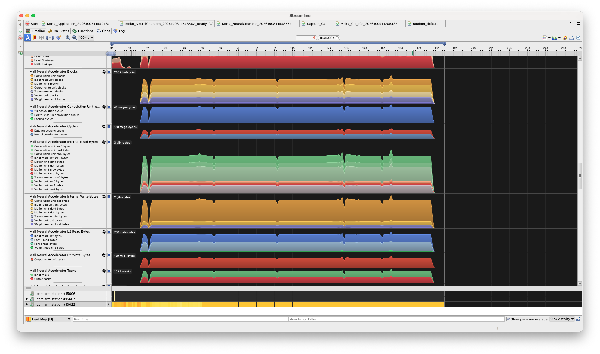

## Understand what a capture records

Streamline samples hardware performance counters on the CPU and GPU to show how your application uses these resources over time. 

This Learning Path assumes you are interested only in GPU-related events and we will omit CPU relating profiling for brevity.

## Profile

The GUI and CLI methods below profile your selected ML for Vulkan workload. Choose one method.




1. Select **Android (adb)** and select your device
2. Select the Application and Activity retrieved from the `adb shell cmd package resolve-activity --brief YOUR_PACKAGE` command in the previous page.
3. To launch the activity on capture, select 'Override Activity' and replace with the activity value. You can also add custom arguments to jump to a point in your app. 
4. Check the 'Use advanced mode' box and use the Mali G2-Ultra - 5th Generation Template


5. Begin capture


When you start capture, Streamline automatically transfers the required utilities, including `gatord`, and Vulkan profiling layers to the device. After capture, you may be prompted to download process images: this optional step copies executables and shared libraries to your computer so Streamline can resolve profiling samples to function names and, when debug information and source files are available, source code.




You will first need to export a session from the GUI, export `session.xml` once from **Use advanced mode > Capture settings**.

Change to the directory where Streamline is installed and run the following command. Replace the relevant arguments for your own application. 

```bash
./Streamline-cli -capture \
  -duration 10 \
  -activity YOUR_ACTIVITY \
  -package YOUR_PACKAGE \
  -template "Mali G2-Ultra - 5th Generation" \
  "/path/to/session.xml"
```

| Optional argument | Purpose |
| --- | --- |
| `-activity YOUR_ACTIVITY` | Override the main activity; required if the package has no single main activity |
| `-activity-args 'YOUR_ARGUMENTS'` | Pass launch arguments as one quoted string; also specify `-activity` |
| `-output "/path/to/YOUR_CAPTURE.apc"` | Choose the capture name and location |

By default, the capture is saved beside the session file with the same base name.




## Check the saved capture

1. Click **Streamline Data** and double-click your saved capture. The default **Timeline** view opens; if another view is selected, click **Timeline**.
2. Scroll down to the **Mali Neural** rows. You should see entries for the neural accelerator counters you collected. If you do not see any activity check that the app was being captured whilst a neural workload was running. 


