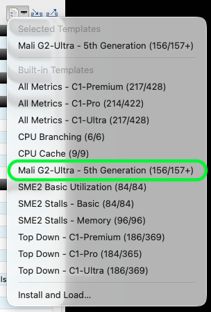
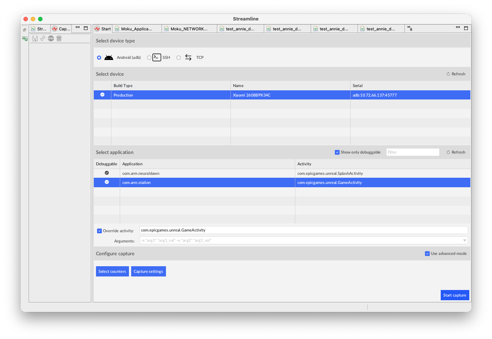

## Understand what a capture records

Streamline samples hardware performance counters on the CPU and GPU to show how your application uses these resources over time. This walkthrough focuses on GPU counters and ML graph execution rather than CPU profiling.

Complete the [device and workload preparation](../prepare-tools-and-device/) first. Use your own debuggable ML for Vulkan application; Moku is only the example shown in the screenshots.

Streamline also supports command-line capture for automation. See the [Streamline 9.9 command-line reference](https://support.arm.com/documentation/101816/9-9/Command-line-reference) for that alternative; the steps below use only the GUI.

## Select the application and counters

1. In the **Start** view, select **Android (adb)** and your device.
2. Select your installed application. Compare its listed activity with the component returned by `adb shell cmd package resolve-activity --brief YOUR_PACKAGE` during preparation.
3. If the listed activity is not the one you need, select **Override activity** and enter the activity class, such as `YOUR_ACTIVITY`, from that component. The selected application already supplies the package name. In **Arguments**, enter only arguments required by your own app, or leave the field empty.
4. Select **Use advanced mode**, then **Select counters**. Open **Add counters from a template**, select **Mali G2-Ultra - 5th Generation** for the example GPU, and click **Save**. Use the corresponding template for your GPU.

5. In **Select counters**, confirm that **Mali Timeline events: Perfetto** is in **Events to collect**, then click **Save**. The G2-Ultra template includes this event and the neural activity, utilization, and L2 traffic counters used on the next page.
6. In **Capture settings**, leave **GPU Timeline layer driver** set to **Auto**. With the Perfetto event selected, Streamline deploys and enables the layer automatically.

## Record about 30 seconds

Unlock the device before starting capture and keep the app visible. If necessary, increase the screen timeout and record its original value so you can restore it afterwards. Streamline launches the selected activity when capture begins; you do not need to start it separately.

1. Click **Start capture**, choose a capture name and save location, and wait for device setup and application launch.
2. Run the intended ML workload, using your app's controls or launch configuration to reach it. Keep loading separate from the interval you want to inspect.
3. After about 30 seconds of capture, click **Stop capture and analyze**. If the application exits earlier, the capture can be shorter; check the saved duration rather than assuming it contains 30 seconds of useful workload activity.

Streamline automatically transfers the required utilities, including `gatord`, and Vulkan profiling layers to the device. If setup fails, check the capture log and the debugging permissions from the preparation page instead of assuming that Timeline data was collected.

After capture, you may be prompted to download process images. This optional step copies executables and shared libraries to your computer so Streamline can resolve profiling samples to function names and, when debug information and source files are available, source code. It is not required to inspect NX hardware counters and graph-operation statistics.

## Check the saved capture

1. Click **Streamline Data** and double-click your saved capture. The default **Timeline** view opens; if another view is selected, click **Timeline**.
2. Confirm that the capture identifies the intended device and application package, and check its duration. Review the capture log, **Warnings**, and any data-loss bookmarks.
3. Expand **Mali Neural Accelerator Overview** and inspect **Neural Accelerator Usage**. Nonzero neural accelerator activity in the workload interval shows that the selected counters recorded NX activity. If it is absent, confirm that the intended workload ran rather than just a loading screen.
4. In the details panel menu at the bottom of **Timeline**, select **Mali Timeline** and confirm that GPU workload events are present. Counter data and Timeline events are separate checks; a saved `.apc` alone is not evidence of either.

Next, [inspect NX activity and graph operations](../analyze-neural-workloads/) to establish where your application's operations executed.
