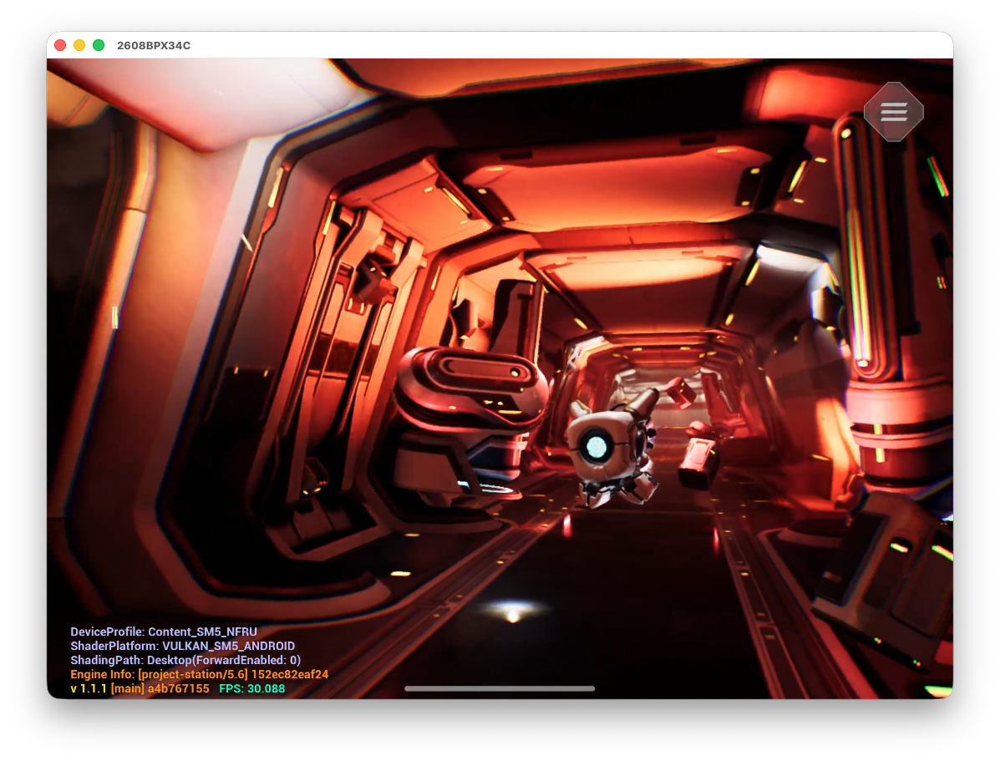

## What NX adds to an Arm GPU

Neural accelerator (NX) provides dedicated neural acceleration within supported Arm GPUs. An ML graph can contain work mapped to NX and work implemented as compute shaders on GPU shader cores.

Arm ML Extensions for Vulkan, including `VK_ARM_tensors` and `VK_ARM_data_graph`, let applications describe tensor data and dispatch machine learning graphs through Vulkan. A graph dispatch can execute work on both NX and shader cores. The compiler maps graph operations to these execution engines. The mapping happens according to the operations, tensor data types and shapes, and capabilities of the target GPU and driver.

Neural graphics techniques use these capabilities within a rendering pipeline. Neural Super Sampling (NSS) reconstructs an image from a lower-resolution input. Neural Frame Rate Upscaling (NFRU) generates intermediate frames between rendered frames. For a broader set of potential use cases, see the [Arm Neural Technology Playbook - Evaluate](/learning-paths/mobile-graphics-and-gaming/neural-graphics-playbook-evaluate/).

## What Streamline shows you

Arm Streamline is a performance analyzer included in Arm Performance Studio. It brings CPU activity, GPU counters, and timeline events into a capture that you can inspect in its graphical interface.
For NX workloads, you'll use two complementary views:

| View | Question it helps you answer |
| --- | --- |
| Mali Timeline | When was a graph submitted and executed, and how did it overlap with other GPU work? |
| Dispatch Graph Workloads: Mali Timeline | Which graph operations took time, and which ran on NX or shader cores? |

Counters summarize activity over sampling intervals. Events describe work along a timeline. NX statistics add detail about neural execution. Reading these together helps you choose an operation to investigate without mistaking a busy interval for proof of a bottleneck.

## What Project Moku is

Project Moku is an Unreal Engine sample project developed by Arm that demonstrates neural rendering technologies for mobile platforms. It provides a controlled environment for testing Neural Frame Rate Upscaling (NFRU) and complementary neural rendering techniques. It's designed to exercise dedicated neural accelerators on GPUs with built-in neural processing support. For more context, see [the introduction to Project Moku](/learning-paths/mobile-graphics-and-gaming/nfru-cases-study/1-introduction_to_moku/).

To complete the Learning Path, you'll use your own installed, debuggable Android application with a supported ML for Vulkan workload. [Project Moku](/learning-paths/mobile-graphics-and-gaming/nfru-cases-study/1-introduction_to_moku/) is used in the Learning Path as an example.

The example captures in the Learning Path use the NFRU configuration of Moku. The scene, settings, and measurements of the captures aren't performance guarantees for your application. The [Arm ML SDK for Vulkan](https://github.com/arm/ai-ml-sdk-for-vulkan) provides tools and documentation for developing applications with these extensions.

For details about sample and frame generation, see [Analyze Neural Frame Rate Upscaling using Project Moku](/learning-paths/mobile-graphics-and-gaming/nfru-cases-study/).

{}

Project Moku screenshots were captured on a [Xiaomi 18 Fold](https://www.mi.com/global/discover/article?id=6357) with a [Mali G2-Ultra NX GPU](https://www.arm.com/products/silicon-ip-multimedia/gpu/mali-g2-ultra-nx). The device display was streamed to the local machine using [`scrcpy`](https://github.com/genymobile/scrcpy).

{}

## What you've learned and what's next

You now know how NX, shader execution, and Vulkan graph dispatches relate to the two Streamline views. You've also learned how Project Moku illustrates the workflow that you'll apply to your own application.

Next, you'll prepare the tools, device, and your workload.
