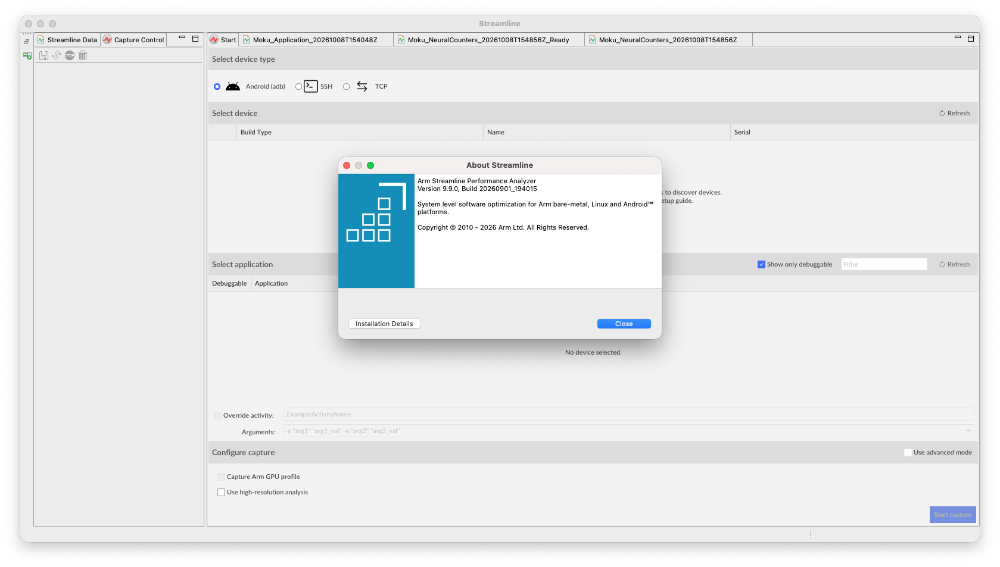
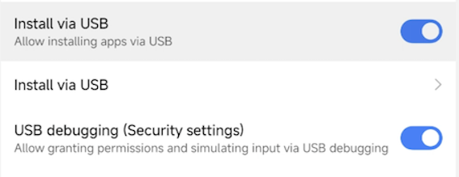
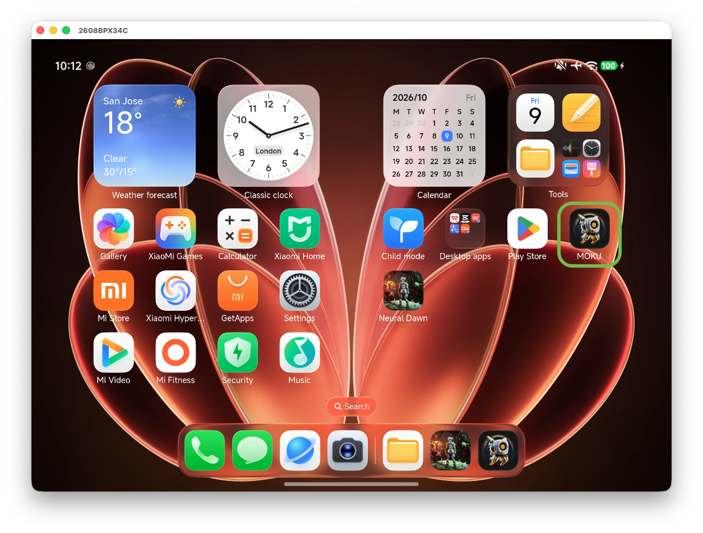

## Install Arm Performance Studio and open Streamline

Install the package for your host using the [Arm Performance Studio install guide](/install-guides/ams/). Open the Performance Studio Hub and launch Streamline.

Confirm that you're using Streamline version 9.9 or later. On macOS, select **Streamline > About Streamline** to check the version. An older installation can support general GPU profiling without supporting the neural accelerator (NX) workflow.



## Connect an Android device with adb

Install the [Android SDK Platform Tools](https://developer.android.com/tools/releases/platform-tools) for your platform and add its directory to your host's `PATH`.

Enable **Developer options** on the Android device, typically by opening **Settings > About phone** and tapping **Build number** seven times. Then, enable **USB debugging**, usually under **Settings > System > Developer options**. The exact labels and locations vary by manufacturer. For more information, see the [Android developer options guidance](https://developer.android.com/studio/debug/dev-options).

Connect the device with a USB data cable, unlock it, and accept the debugging authorization prompt.

{}
If you're using a Xiaomi device, enable **Developer options > USB debugging (Security settings)**. The setting allows Streamline to configure the Vulkan Timeline layer for Dispatch Graph profiling.


{}

In a terminal, check the host tool and device connection:

```bash
adb devices -l
```

You should see a device serial number and product details for each attached device. A wireless `adb` connection uses `<IP address>:<port number>` instead of a USB serial number.

The output is similar to:

```out
List of devices attached
10.72.66.137:33735     device product:lhasa model:2608BPX34C device:lhasa transport_id:3
```

Your selected device has to appear with status `device`. If the status is `unauthorized`, accept the prompt.

{}
If more than one device is listed, add `-s YOUR_DEVICE_SERIAL` after `adb` in each subsequent command. Replace `YOUR_DEVICE_SERIAL` with the serial number of the device that you're using to complete the Learning Path.
{}

In Streamline's **Start** view, select the **Android (adb)** radio button. Your connected device should appear under **Select device**. Select it to list its filtered debuggable applications.

Confirm that the Perfetto service is running. The service is required for Mali Timeline events and is separate from USB debugging authorization:

```bash
adb shell pidof traced || echo "Perfetto service not running"
```

The expected output is a process ID. 

If no process ID appears, first record the current setting:

```bash
adb shell getprop persist.traced.enable
```

Then, try enabling the service and repeat the process check:

```bash
adb shell setprop persist.traced.enable 1
adb shell pidof traced
```

Don't continue without a running service. If the service can't be enabled, consult the [Streamline Android target setup guide](https://support.arm.com/documentation/101813/9-9). If you change this persistent setting, restore its recorded value after profiling.

## Check GPU and driver information

For a brief check against the hardware and driver prerequisites, dump the Vulkan properties and filter for the GPU and driver fields:

```bash
adb shell cmd gpu vkjson |
  grep -E '"(deviceName|driverName|driverInfo|driverVersion)"'
```

The Xiaomi 18 Fold used to test this Learning Path returned the following values. Repeated fields are omitted:

```output
"driverInfo" : "v1.r56p0-15bet0.62068c9e2b6dab93feff4ddf773d9a12",
"driverName" : "Mali-G2-Ultra-NX MC16"
"deviceName" : "Mali-G2-Ultra-NX MC16",
"driverVersion" : 234881024.0,
```

## Confirm your installed workload

Replace `YOUR_PACKAGE` with the package ID of your application. Check debug access and resolve its launch activity using the [Android activity documentation](https://developer.android.com/guide/components/activities/intro-activities):

```bash
adb shell run-as YOUR_PACKAGE id
adb shell cmd package resolve-activity --brief YOUR_PACKAGE
```

The first command should print the UID and group information of the application. If it reports that the package isn't debuggable, obtain a debuggable build before continuing. The final command should return the package or activity component to select in Streamline. For example, Moku returns:

```output
com.arm.station/com.epicgames.unreal.GameActivity
```

Unlock the device and launch your app once. Confirm that its intended ML workload runs. Note any navigation or application-specific arguments that are required to reach it. Streamline can launch the app again when capture starts.

The following screenshot shows Moku installed on a Xiaomi 18 Fold.



## Enable NX statistics collection

NX statistics supplement GPU timeline events with information about neural execution. Record the existing setting, including whether the output is blank, before changing it:

```bash
adb shell getprop debug.mali.statistics_mode
```

Then, enable per-unit statistics and verify the new setting:

```bash
adb shell setprop debug.mali.statistics_mode 2
adb shell getprop debug.mali.statistics_mode
```

The final query should return `2`. This property configures statistics collection but doesn't identify the DDK. 

If the property can't be set, stop and consult the profiling setup documentation for your device. Don't assume that statistics are enabled.

The following modes are described in the [Streamline ML workload setup guide](https://support.arm.com/documentation/101816/9-9/Getting-started-with-Streamline/Configure-your-system-to-profile-ML-for-Vulkan-workloads):

| Mode | Collected data |
| --- | --- |
| `0` | NX statistics disabled |
| `1` | Per-section cycle counts |
| `2` | Per-unit counters; the documented default |


When you capture your workload using the Streamline GUI, the capture automatically deploys and enables the Mali Timeline layer. You don't need to set `debug.vulkan.layers` manually.

After analysis, [restore any settings that you changed](/learning-paths/mobile-graphics-and-gaming/streamline-nx/analyze-neural-workloads/#restore-device-settings) to their recorded values. Don't unconditionally disable statistics.

## What you've accomplished and what's next

You've connected the device, checked Perfetto, and prepared your own debuggable workload for NX statistics collection.

Next, you'll capture your workload using the Streamline GUI.
