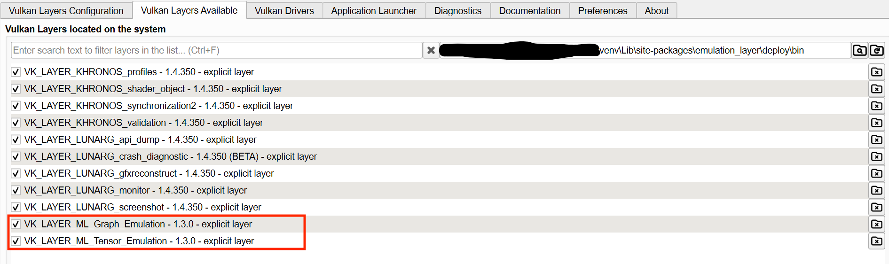
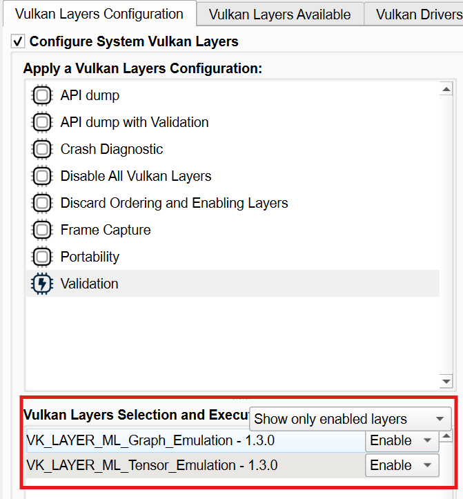

## Overview

To run the Vulkan Samples, you first need to set up your development environment.

This setup involves three main steps:

- Create a Python virtual environment and install the ML Emulation Layers for Vulkan.
- Install the LunarG Vulkan SDK.
- Enable the ML Emulation Layers using Vulkan Configurator.

## Set up the development environment

Open **Windows PowerShell** from the Windows 11 Start menu. Verify that Python 3.10 or later is installed. Use a standard CPython build rather than a free-threaded build, then navigate to your user home directory:

```powershell
python --version
cd $HOME
```

Create a Python virtual environment and install the following packages:

- **ML Emulation Layers for Vulkan:** Provides the emulation layers introduced in the previous section.
- **CMake:** A build tool used to configure and build the Vulkan Samples.

```powershell
python -m venv .venv
.\.venv\Scripts\Activate.ps1
python -m pip install --upgrade pip
python -m pip install ai-ml-emulation-layer-for-vulkan cmake
```

To verify your installation, run the following commands:

```powershell
cmake --version
python --version
git --version
python -m pip show ai-ml-emulation-layer-for-vulkan
```

Each command prints the installed version of the tool or shows where the appropriate files are located.


## Install the Vulkan Software Development Kit

Arm's ML SDK for Vulkan and the LunarG Vulkan SDK serve different purposes.

Arm's ML SDK for Vulkan provides the ML Emulation Layers installed earlier in this Learning Path. The LunarG Vulkan SDK provides Vulkan development tools, including Vulkan Configurator, which you'll use to enable those layers.

The two SDKs work together to provide a development environment where you can build and run Vulkan applications using the emulated ML extensions.

Download and install the Vulkan SDK from [Getting Started with the Windows Vulkan SDK](https://vulkan.lunarg.com/sdk/home).

1. Under **Windows**, select **x64 / x86**.
2. Download the **SDK Installer** for version 1.4.321 or later. Do not select the Runtime Installer.
3. Run the installer and accept the default installation directory.
4. Keep the default component selections and accept the license agreement.
5. Complete the installation.
6. On the final screen, select **Run the Vulkan Configurator and Hardware Capabilities Viewer**, then click **Finish**.

Verify that Vulkan Configurator opens successfully. You will use it in the next section to enable the ML Emulation Layers for Vulkan.

## Enable the emulation layers in Vulkan Configurator

Installing the ML Emulation Layers makes them available on your system, but they must also be enabled so that Vulkan applications can discover and use the emulated ML extensions.

If Vulkan Configurator is not already open, launch it from the Windows Start menu.

In **Vulkan Configurator**, configure the emulation layers for the `VK_ARM_data_graph` and `VK_ARM_tensors` extensions.

1. In the **Vulkan Layers Available** tab, add the directory containing the emulation layer manifests from your Python virtual environment:

   ```text
   .venv\Lib\site-packages\emulation_layer\deploy\bin
   ```

   For example, if you created the virtual environment in your Windows user home directory, the path is:

   ```text
   C:\Users\<username>\.venv\Lib\site-packages\emulation_layer\deploy\bin
   ```

2. Verify that the following layers appear in the available layers list:
   - `VK_LAYER_ML_Graph_Emulation`
   - `VK_LAYER_ML_Tensor_Emulation`



3. In the **Vulkan Layers Configuration** tab, enable system Vulkan layer configuration and ensure both emulation layers are set to **Enable**.

4. Verify that the **Graph Emulation** layer is listed above the **Tensor Emulation** layer.



{}
Keep Vulkan Configurator running while you run the Vulkan samples.
{}

With the emulation layers configured, you're ready to build the Vulkan Samples. Continue to the next section to get started.
