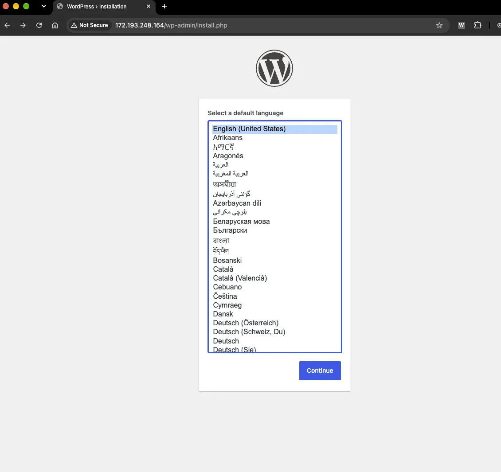

---
# User change
title: "Deploy a WordPress Example"

weight: 3 # 1 is first, 2 is second, etc.

# Do not modify these elements
layout: "learningpathall"
---

## Before you begin

You should have an AKS cluster already running from the previous topic. 

You can use the cluster to deploy an example application, WordPress.

## Deploy WordPress Example

### Create the Kubernetes manifest files

The yaml files below are a modified version of the [Kubernetes WordPress Tutorial](https://kubernetes.io/docs/tutorials/stateful-application/mysql-wordpress-persistent-volume/) in the Kubernetes documentation. 

You will use three yaml files to deploy WordPress on your AKS cluster:

- `kustomization.yaml`
- `mysql-deployment.yaml`
- `wordpress-deployment.yaml`

1. Use a text editor to create the file `kustomization.yaml` with the code below: 

```console
secretGenerator:
- name: mysql-pass
  literals:
  - password=YourPasswordHere
resources:
  - mysql-deployment.yaml
  - wordpress-deployment.yaml
```

2. Use a text editor to create the file `mysql-deployment.yaml` with the code below: 

```console
apiVersion: v1
kind: Service
metadata:
  name: wordpress-mysql
  labels:
    app: wordpress
spec:
  ports:
    - port: 3306
  selector:
    app: wordpress
    tier: mysql
  clusterIP: None
---
apiVersion: v1
kind: PersistentVolumeClaim
metadata:
  name: mysql-pv-claim
  labels:
    app: wordpress
spec:
  accessModes:
    - ReadWriteOnce
  storageClassName: managed-csi
  resources:
    requests:
      storage: 20Gi
---
apiVersion: apps/v1
kind: Deployment
metadata:
  name: wordpress-mysql
  labels:
    app: wordpress
spec:
  selector:
    matchLabels:
      app: wordpress
      tier: mysql
  strategy:
    type: Recreate
  template:
    metadata:
      labels:
        app: wordpress
        tier: mysql
    spec:
      containers:
      - image: mysql:8.4.13
        name: mysql
        env:
        - name: MYSQL_DATABASE
          value: wordpressdb
        - name: MYSQL_ROOT_PASSWORD
          valueFrom:
            secretKeyRef:
              name: mysql-pass
              key: password
        - name: MYSQL_USER
          value: mysqluser
        - name: MYSQL_PASSWORD
          valueFrom:
            secretKeyRef:
              name: mysql-pass
              key: password
        ports:
        - containerPort: 3306
          name: mysql
        volumeMounts:
        - name: mysql-persistent-storage
          mountPath: /var/lib/mysql
      volumes:
      - name: mysql-persistent-storage
        persistentVolumeClaim:
          claimName: mysql-pv-claim
```

3. Use a text editor to create the file `wordpress-deployment.yaml` with the code below: 

```console
apiVersion: v1
kind: Service
metadata:
  name: wordpress
  labels:
    app: wordpress
spec:
  ports:
    - port: 80
  selector:
    app: wordpress
    tier: frontend
  type: LoadBalancer
  loadBalancerSourceRanges: ["0.0.0.0/0"]
---
apiVersion: v1
kind: PersistentVolumeClaim
metadata:
  name: wp-pv-claim
  labels:
    app: wordpress
spec:
  accessModes:
    - ReadWriteOnce
  storageClassName: managed-csi
  resources:
    requests:
      storage: 20Gi
---
apiVersion: apps/v1
kind: Deployment
metadata:
  name: wordpress
  labels:
    app: wordpress
spec:
  selector:
    matchLabels:
      app: wordpress
      tier: frontend
  strategy:
    type: Recreate
  template:
    metadata:
      labels:
        app: wordpress
        tier: frontend
    spec:
      containers:
      - image: wordpress:7.1.5-apache
        name: wordpress
        env:
        - name: WORDPRESS_DB_HOST
          value: wordpress-mysql
        - name: WORDPRESS_DB_PASSWORD
          valueFrom:
            secretKeyRef:
              name: mysql-pass
              key: password
        - name: WORDPRESS_DB_NAME
          value: wordpressdb
        - name: WORDPRESS_DB_USER
          value: mysqluser
        ports:
        - containerPort: 80
          name: wordpress
        volumeMounts:
        - name: wordpress-persistent-storage
          mountPath: /var/www/html
      volumes:
      - name: wordpress-persistent-storage
        persistentVolumeClaim:
          claimName: wp-pv-claim
```

### Apply the manifests

Run `kubectl apply` to update the configuration:

```console
kubectl apply -k ./
```

The output is similar to:

```output
secret/mysql-pass-9mftfh2cbc created
service/wordpress created
service/wordpress-mysql created
persistentvolumeclaim/mysql-pv-claim created
persistentvolumeclaim/wp-pv-claim created
deployment.apps/wordpress created
deployment.apps/wordpress-mysql created
```

### Confirm WordPress is running

1. Check on volume claims to confirm the 20 GiB of storage has been created for MySQL and WordPress:

```console
kubectl get pvc
```

The output is similar to:

```output
NAME             STATUS   VOLUME                                     CAPACITY   ACCESS MODES   STORAGECLASS   VOLUMEATTRIBUTESCLASS   AGE
mysql-pv-claim   Bound    pvc-c1948fd9-1ba1-49e2-9b8e-734fe28bc03e   20Gi       RWO            managed-csi    <unset>                 11s
wp-pv-claim      Bound    pvc-91cf7663-f500-40eb-8011-5c9a27bed3a3   20Gi       RWO            managed-csi    <unset>                 11s
```

2. Verify the WordPress and MySQL pods are running:

```console
kubectl get pods
```

The output is similar to:

```output
NAME                               READY   STATUS    RESTARTS   AGE
wordpress-7b75d8584c-sjt75         1/1     Running   0          61s
wordpress-mysql-585c4786dd-rq74n   1/1     Running   0          61s
```

3. Verify that the persistent volumes have been attached:

```console
kubectl get volumeattachments
```

The output is similar to:

```output
NAME                                                                   ATTACHER             PV                                         NODE                               ATTACHED   AGE
csi-0637ef93dc59f8511dc360b2ea1e1e27b06b2dc01333d1e9b54a2ebd1c5dbfca   disk.csi.azure.com   pvc-c1948fd9-1ba1-49e2-9b8e-734fe28bc03e   aks-demopool-15110407-vmss000002   true       59s
csi-f2eaeaf495901df3b7c1aeeb21b006581f4a52b52da669417b6a7c876b1f8964   disk.csi.azure.com   pvc-91cf7663-f500-40eb-8011-5c9a27bed3a3   aks-demopool-15110407-vmss000000   true       58s
```

4. Get the external IP address of the WordPress deployment:

```console
kubectl get svc
```

The output is similar to:

```output
NAME              TYPE           CLUSTER-IP    EXTERNAL-IP       PORT(S)        AGE
kubernetes        ClusterIP      10.0.0.1      <none>            443/TCP        6m50s
wordpress         LoadBalancer   10.0.90.248   172.193.248.164   80:32351/TCP   13s
wordpress-mysql   ClusterIP      None          <none>            3306/TCP       13s
```

The IP address in the `EXTERNAL-IP` column is the one to use.

5. Open the external IP in a browser.

The WordPress language selection screen is displayed.



You have successfully installed WordPress on your Arm-based AKS cluster.

### Clean up resources

Run `terraform destroy` in the directory that contains your Terraform files to delete the AKS cluster and the resource group. This also deletes the WordPress volumes and the load balancer.

```console
terraform destroy
```

Answer `yes` at the prompt to destroy all resources. 
