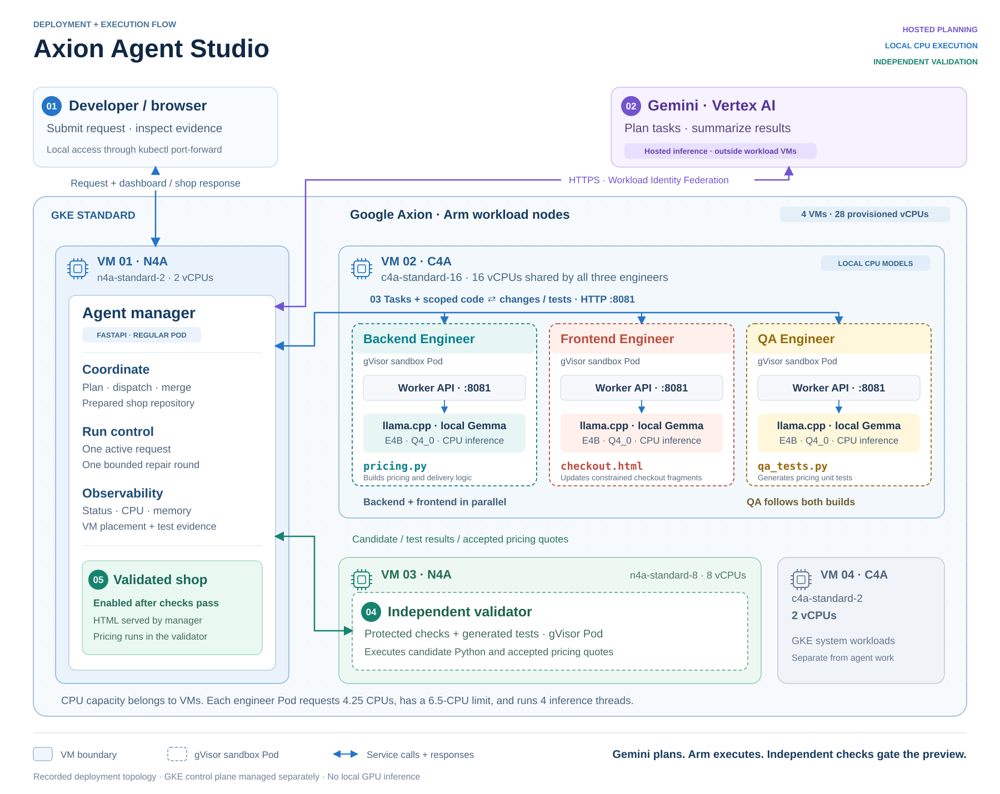

## Follow the request from plan to preview

Use Axion Agent Studio to add a discount and shipping rule to a prepared shop. Hosted Gemini plans the work, and local Gemma workers implement and test it on Arm-based Google Axion CPUs.

Google Kubernetes Engine (GKE) schedules the workloads, and Agent Sandbox manages the isolated worker environments. This Learning Path extends [Run agent-generated Python in GKE Agent Sandbox on Google Axion](/learning-paths/servers-and-cloud-computing/gke-agent-sandbox/) with a multi-role application workflow. You start with an existing compatible cluster.

The prepared repository contains a working storefront, catalog, and checkout. You submit a request to change its pricing policy and display. The manager provides the relevant source files and role instructions to each worker.

[Open the full-size architecture diagram (SVG)](../images/architecture-technical.svg) · [Download the high-resolution PNG](../images/architecture-technical.png)

1. The **manager** calls hosted Gemini through Vertex AI to extract a supported policy and a plan for three roles.
2. The **Backend Engineer** and **Frontend Engineer** run concurrently. Each calls its own local Gemma server. The backend produces `pricing.py`. The frontend produces four constrained fragments that the worker assembles into the existing `checkout.html`.
3. The manager combines the non-overlapping files. The **Quality Assurance (QA) Engineer** then generates `qa_tests.py` against this combined candidate.
4. The **validator** executes protected pricing checks and the agent-written tests in a separate gVisor sandbox. The manager can request one bounded repair round if validation fails.
5. After the checks pass, the manager requests a hosted Gemini summary and then enables the updated shop. If the summary is unavailable, a passed validation still permits the preview. The deterministic checks control the preview gate; the summary does not approve the code.

The manager serves the dashboard and checkout HTML. For a validated basket, it forwards the quote request to the validator, which executes the accepted pricing code. Each run creates candidate files and a preview URL, not a new public application deployment.

## Separate the infrastructure layers

A **virtual machine (VM)** is a GKE worker node with CPU and memory. A **Pod** is a Kubernetes workload scheduled onto a node. Here, a **Sandbox resource** manages a worker Pod's lifecycle, and the Pod selects the **gVisor runtime** to isolate execution. The sandbox uses its underlying VM's CPU; it does not obtain a separate model API compute service.

Each engineer's Pod contains a worker HTTP service and a `llama-server` process. The model endpoint listens on Pod loopback. The manager calls the worker service, which sends inference requests to that local endpoint. All three roles use the same model weights with different instructions and output contracts.

| Workload | Recorded VM placement | What runs there |
| --- | --- | --- |
| Manager, dashboard, and shop serving | One `n4a-standard-2` regular node | Python coordination, API calls, status, HTML serving |
| Backend, frontend, and QA workers | One shared `c4a-standard-16` sandbox node | Three local Gemma servers and worker services |
| Independent validator | One `n4a-standard-8` sandbox node | Protected checks, generated tests, accepted pricing code |
| GKE system workloads | One `c4a-standard-2` regular node | Cluster support workloads |

The recorded environment has four VMs with 28 vCPUs in total. The three engineer cards share one 16-vCPU VM. The GKE control plane is managed separately.

C4A hosts the generation work in this tested arrangement. N4A hosts coordination and validation. These are placement choices demonstrated by this application, not a measured claim that either machine family is optimal for every workload.

## Identify what the Arm CPUs do

Axion CPUs run local model inference, coordination, file assembly, tests, and shop serving. Hosted Gemini inference runs outside these VMs. The demo uses no GPU for the local Gemma workers: their llama.cpp arguments include `--n-gpu-layers 0`.

The application restricts the task to percentage discounts, subtotal thresholds, shipping charges, and the existing checkout display. Login, payments, database migrations, new quote fields, and arbitrary UI redesigns are outside this contract. That boundary makes the generated result practical to verify.

## What you have learned

You can distinguish hosted planning from local inference and map each workload to its VM and isolation boundary. Next, verify that your environment provides those resources and the required Sandbox API.
