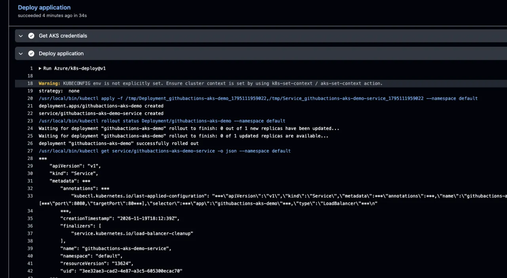

You'll build a .NET 10 web application using a self-hosted GitHub Actions Arm64 runner and deploy it to an Azure Kubernetes Service cluster with Azure Cobalt 200-based VMs. Self-hosted runners offer increased control and flexibility in terms of infrastructure, operating systems, and tools, in comparison to GitHub-hosted runners.

{}
* GitHub-hosted Arm64 runners have now reached General Availability. If your GitHub account is part of a Team or an Enterprise Cloud plan, you can use GitHub-hosted Arm64 runners. 

* To learn how you can configure a GitHub-managed runner, see the Learning Path [*Build multi-architecture container images with GitHub Arm-hosted runners*](/learning-paths/cross-platform/github-arm-runners/).
{}

## How do I create an Azure Virtual Machine?
Creating a virtual machine based on Azure Cobalt 200 is no different from creating any other VM in Azure. To create an Azure virtual machine, launch the [Azure portal](https://portal.azure.com/) and navigate to Virtual Machines. 

Select **Create Azure Virtual Machine**, and fill in details such as **Name** and **Region**. Select **Ubuntu Server 24.04 LTS** as the image and **Arm64** as the VM architecture.

In the **Size** field, select **See all sizes**. The Cobalt 200 sizes might appear under **Other sizes**. Select **D2ps_v7** from the **D-series v7** family, configure SSH public key authentication, and create the VM.

Your subscription and selected region must have access to Dpsv7 sizes and sufficient vCPU quota. This Learning Path was validated in **West US 2**.

After the VM is running, connect with SSH and verify the architecture and CPU model:

```console
uname -m
lscpu | grep 'Model name'
```

The output is similar to:

```output
aarch64
Model name:                              Neoverse-V3
```

{}
To learn more about Arm-based VMs in Azure, refer to "Getting Started with Microsoft Azure" in  [*Get started with Arm-based cloud instances*](/learning-paths/servers-and-cloud-computing/csp/azure/).
{}

## How do I configure the GitHub repository?

The source code and configuration files are hosted in the [msbuild-azure GitHub repository](https://github.com/pbk8s/msbuild-azure). The repository also contains the Dockerfile and Kubernetes deployment manifests. After forking it, you'll update the application to use .NET 10.

Fork the repository first. Then prepare the VM and configure the runner.

### Install the tools the workflow needs on the VM

The workflow builds a container image, runs Azure CLI commands, and deploys with `kubectl` on the runner. Connect to the `D2ps_v7` VM you created in the previous step and install these tools before you configure the runner:

* Docker Engine. Follow the [Docker Engine install guide](/install-guides/docker/docker-engine/).
* Azure CLI. Follow the [Azure CLI install guide](/install-guides/azure-cli/).
* `kubectl`. Follow the [kubectl install guide](/install-guides/kubectl/).

Confirm that each tool works:

```console
docker run --rm hello-world
az version
kubectl version --client
```

The `docker` command must work without `sudo`.

### Configure the runner

1. In your fork, navigate to the **Settings** tab and select **Actions** in the navigation pane.

2. In **Runners**, select **New self-hosted runner** to configure the runner.

3. For **Runner image**, select **Linux**, and for **Architecture**, select **ARM64**.

4. Run the commands shown on the `D2ps_v7` VM to download, extract, and configure the runner.

5. After you run `config.sh`, install and start the runner as a service so it keeps running after you close your SSH session. Run these commands from the runner directory:

   ```console
   sudo ./svc.sh install
   sudo ./svc.sh start
   sudo ./svc.sh status
   ```

   The status output shows `active (running)` and `Listening for Jobs`.

6. Confirm that the self-hosted runner appears on the same GitHub page with the **Idle** status.

{}
To learn more about creating an Arm-based self-hosted runner, see [Use Self-Hosted Arm64-based runners in GitHub Actions for CI/CD](/learning-paths/laptops-and-desktops/self_hosted_cicd_github/).
{}

## How do I create an AKS cluster with Arm-based Azure Cobalt 200 nodes using Terraform?

To create an Arm-based AKS cluster, follow [Create an Arm-based Kubernetes cluster on Microsoft Azure Kubernetes Service](/learning-paths/servers-and-cloud-computing/aks/cluster_deployment/). The Terraform configuration in that Learning Path uses the Cobalt 200 `Standard_D2ps_v7` VM size for the cluster nodes and **West US 2** as the default region.

Your subscription and selected region must have access to Dpsv7 sizes and sufficient vCPU quota.

Note the `resource_group_name` and `cluster_name` values that Terraform prints. You use them later as the `CLUSTER_RESOURCE_GROUP_NAME` and `CLUSTER_NAME` GitHub secrets.

After the cluster is created, connect to it and confirm that the nodes use the Cobalt 200 VM size and the `arm64` architecture:

```console
kubectl get nodes -L node.kubernetes.io/instance-type,kubernetes.io/arch
```

The output is similar to:

```output
NAME                               STATUS   ROLES    AGE     VERSION   INSTANCE-TYPE      ARCH
aks-demopool-33234337-vmss000000   Ready    <none>   2m43s   v1.36.5   Standard_D2ps_v7   arm64
aks-demopool-33234337-vmss000001   Ready    <none>   2m45s   v1.36.5   Standard_D2ps_v7   arm64
aks-demopool-33234337-vmss000002   Ready    <none>   2m19s   v1.36.5   Standard_D2ps_v7   arm64
```

Once you have successfully created the cluster, you can proceed to the next section.

## How do I create a container registry with Azure Container Registry (ACR)?

To create a container registry in Azure Container Registry to host the Docker images for your application, use the following command. Replace `<resource-group>` and `<acr-name>` with your resource group and a globally unique registry name:

```console
az acr create --resource-group <resource-group> --name <acr-name> --sku Basic
```

Use the registry name, without `.azurecr.io`, for the `ACR_Name` GitHub secret in the next section.

Allow the AKS cluster to pull images from the registry. Replace the placeholders with your cluster resource group, cluster name, and registry name:

```console
az aks update --resource-group <cluster-resource-group> --name <cluster-name> --attach-acr <acr-name>
```

This command needs permission to create role assignments. For registries using repository-level ABAC permissions, follow the [AKS and ACR authentication guidance](https://learn.microsoft.com/en-us/azure/aks/cluster-container-registry-integration) instead.
## How do I set up GitHub Secrets?

The next step allows GitHub Actions to access the Azure Container Registry to push application docker images and Azure Kubernetes Service to deploy application pods. 

Create the following secrets in your GitHub repository:

- Populate `ACR_Name` with the name of your Azure Container Registry.
- Populate `AZURE_CREDENTIALS` with the JSON output of the service principal command in the next section.
- Populate `CLUSTER_NAME` with the name of your AKS cluster.
- Populate `CLUSTER_RESOURCE_GROUP_NAME` with the name of your resource group.

### Create a service principal for GitHub Actions

The `AZURE_CREDENTIALS` secret holds a service principal that GitHub Actions uses to push images to the registry and deploy to the cluster. Get your subscription ID:

```console
SUB=$(az account show --query id -o tsv)
echo $SUB
```

Create the service principal with the Contributor role on the resource group that contains your registry. Replace `<registry-resource-group>` with that resource group:

```console
az ad sp create-for-rbac --name cobalt200-gh-actions --role contributor --scopes /subscriptions/$SUB/resourceGroups/<registry-resource-group> --json-auth
```

The command prints a JSON document that contains a client secret. Copy the entire JSON output, including the braces, into the `AZURE_CREDENTIALS` secret. You can't view the secret again later. Don't commit it or share it.

{}
Some Azure CLI versions print a warning that `--sdk-auth` is deprecated when you use `--json-auth`. The output is the same, and you can ignore the warning.
{}

Give the service principal the same role on the resource group that contains your AKS cluster. Replace `<cluster-resource-group>` with that resource group:

```console
APPID=$(az ad sp list --display-name cobalt200-gh-actions --query "[0].appId" -o tsv)
az role assignment create --assignee $APPID --role contributor --scope /subscriptions/$SUB/resourceGroups/<cluster-resource-group>
```

If your registry and cluster are in the same resource group, skip this step.

Refer to this [guide](https://learn.microsoft.com/en-us/azure/developer/github/connect-from-azure-secret) for further information about signing into Azure using GitHub Actions. 

## Deploy a .NET-based application 

.NET supports Arm64 applications. Update the example application to use the .NET 10 SDK and runtime.

In your fork of the GitHub repository, edit `aks-ga-demo.csproj` and set `TargetFramework` to `net10.0`:

```xml
<Project Sdk="Microsoft.NET.Sdk.Web">

  <PropertyGroup>
    <TargetFramework>net10.0</TargetFramework>
    <RootNamespace>aks_ga_demo</RootNamespace>
  </PropertyGroup>

</Project>
```

Update the `Dockerfile` in your fork to use .NET 10 in the base and build stages. Set `ASPNETCORE_URLS` so the application listens on port 80, matching the Kubernetes manifests. This is a multi-stage Dockerfile with the following stages:

1. `base` stage - prepares the base environment with the .NET 10 SDK and exposes ports 80 and 443.

2. `build` stage - restores dependencies and builds the application.

3. `publish` stage - publishes the application making it ready for deployment.

4. `final` stage - copies the published application into the final image and sets the entry point to run the application.

Replace the contents of `Dockerfile` with:

```dockerfile
FROM mcr.microsoft.com/dotnet/sdk:10.0 AS base
WORKDIR /app
EXPOSE 80
EXPOSE 443
ENV ASPNETCORE_URLS=http://+:80

FROM mcr.microsoft.com/dotnet/sdk:10.0 AS build
WORKDIR /src
COPY ["aks-ga-demo.csproj", "./"]
RUN dotnet restore "./aks-ga-demo.csproj"
COPY . .
WORKDIR "/src/."
RUN dotnet build "aks-ga-demo.csproj" -c Release -o /app/build

FROM build AS publish
RUN dotnet publish "aks-ga-demo.csproj" -c Release -o /app/publish

FROM base AS final
WORKDIR /app
COPY --from=publish /app/publish .
ENTRYPOINT ["dotnet", "aks-ga-demo.dll"]
```

Next, edit `k8s/deployment.yml` in your fork. Replace `msbuilddemo` in the image name with your own registry name, matching `ACR_Name`. The file defines the application deployment and exposes port 80. The following example uses `<acr-name>` as a placeholder; replace it with your registry name:

```yaml
apiVersion: apps/v1
kind: Deployment
metadata:
  name: githubactions-aks-demo
spec:
  selector:
    matchLabels:
      app: githubactions-aks-demo
  template:
    metadata:
      labels:
        app: githubactions-aks-demo
    spec:
      containers:
      - name: githubactions-aks-demo
        image: <acr-name>.azurecr.io/githubactions-aks-demo
        resources:
          limits:
            memory: "128Mi"
            cpu: "500m"
        ports:
        - containerPort: 80
```

The `service.yml` file defines a `Service` and uses `LoadBalancer` to expose the service externally on port 8080, directing traffic to the application's container on port 80.

```yaml
apiVersion: v1
kind: Service
metadata:
  name: githubactions-aks-demo-service
spec:
  selector:
    app: githubactions-aks-demo
  type: LoadBalancer
  ports:
  - port: 8080
    targetPort: 80
```

Finally, replace `.github/workflows/deploytoAKS.yml` in your fork with the following workflow. It uses the `ACR_Name` secret for registry login, image pushes, and deployment:

```yaml
name: Deploy .NET app

on:
  workflow_dispatch:
  push:
  

jobs:
  deploy:
    name: Deploy application
    runs-on: self-hosted
    env:
      ACR_NAME: ${{ secrets.ACR_Name }}
    
    steps:
      - name: Checkout repo
        uses: actions/checkout@v2

      - name: Build image
        run: docker build -t githubactions-aks-demo:'${{github.sha}}' .
      
      - name: Azure login
        uses: azure/login@v1.4.6
        with:
          creds: '${{ secrets.AZURE_CREDENTIALS }}'

      - name: ACR login
        run: az acr login --name "$ACR_NAME"

      - name: Tag and push image
        run: |
          docker tag githubactions-aks-demo:'${{github.sha}}' "$ACR_NAME.azurecr.io/githubactions-aks-demo:${{github.sha}}"
          docker push "$ACR_NAME.azurecr.io/githubactions-aks-demo:${{github.sha}}"

      - name: Get AKS credentials
        env:
          CLUSTER_RESOURCE_GROUP_NAME: ${{ secrets.CLUSTER_RESOURCE_GROUP_NAME }}
          CLUSTER_NAME: ${{ secrets.CLUSTER_NAME }}
        run: |
          az aks get-credentials \
            --resource-group $CLUSTER_RESOURCE_GROUP_NAME \
            --name $CLUSTER_NAME \
            --overwrite-existing
      
      - name: Deploy application
        uses: Azure/k8s-deploy@v1
        with:
          action: deploy
          manifests: |
           k8s/deployment.yml
           k8s/service.yml
          images: |
            ${{ secrets.ACR_Name }}.azurecr.io/githubactions-aks-demo:${{ github.sha }}
```

Commit and push the updated project file, Dockerfile, deployment manifest, and workflow to your fork. A push also triggers the workflow.

This GitHub Actions yaml file defines a workflow to deploy a .NET application to Azure Kubernetes Service (AKS). This workflow runs on the self-hosted GitHub Actions runner that you configured in a previous step. This workflow can be triggered manually, or on a push to the repository. 

It has the following main steps:

1. `Checkout repo` - checks out the repository code.
2. `Build image` - builds a Docker image of the application.
3. `Azure login` - logs in to Azure using stored credentials in GitHub Secrets.
4. `ACR login` - logs in to Azure Container Registry (ACR).
5. `Tag and push image` - tags and pushes the Docker image to Azure Container Registry.
6. `Get AKS credentials` - retrieves Azure Kubernetes Cluster credentials.
7. `Deploy application` - deploys the application to AKS using specified Kubernetes manifests.

## How do I run the CI/CD pipeline?

To trigger the pipeline manually, navigate to the **Actions** tab in the GitHub repository. Select **Deploy .NET app**, then select **Run Workflow**. You can also run the pipeline by making a commit to the repository. When the pipeline runs successfully, the Actions output looks similar to this:



Check your Kubernetes cluster for the new application pod:

```console
kubectl get pods -o wide
```

The output is similar to:

```output
NAME                                      READY   STATUS    RESTARTS   AGE   IP             NODE                               NOMINATED NODE   READINESS GATES
githubactions-aks-demo-8667bb85bc-w8tqq   1/1     Running   0          92s   10.244.2.185   aks-demopool-33234337-vmss000002   <none>           <none>
```

The pod runs on one of the `Standard_D2ps_v7` Arm64 nodes you created earlier. Next, check the service:

```console
kubectl get service githubactions-aks-demo-service
```

The output is similar to:

```output
NAME                             TYPE           CLUSTER-IP    EXTERNAL-IP      PORT(S)          AGE
githubactions-aks-demo-service   LoadBalancer   10.0.217.54   48.202.105.207   8080:31431/TCP   102s
```

Use the `EXTERNAL-IP` value from your own output to test the application:

```console
curl -s -o /dev/null -w "%{http_code}\n" http://<external-ip>:8080/
```

The command prints `200`. You can also open `http://<external-ip>:8080/` in a browser.
