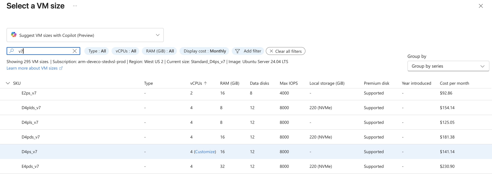
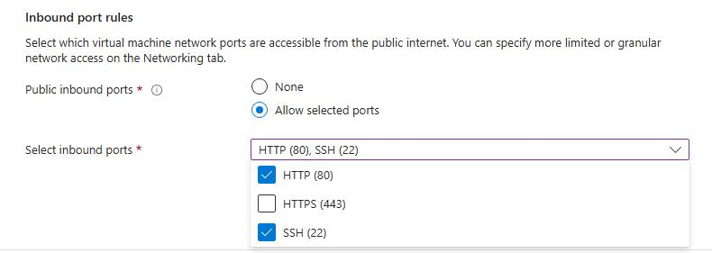
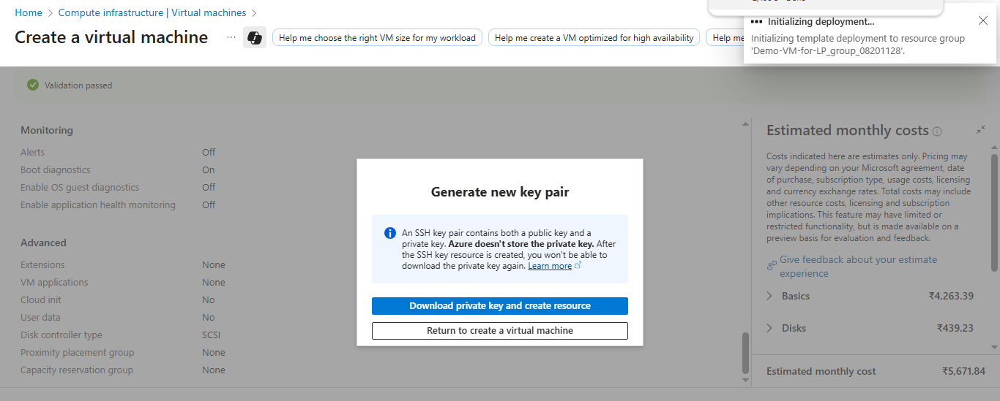

## Introduction

There are several ways to create an Arm-based Cobalt 200 virtual machine:

- The Azure console
- The Azure CLI
- An infrastructure as code (IaC) tool

In this section, you will use the Azure console to create a virtual machine with the Arm-based Azure Cobalt 200 processor.

Use a general-purpose **Standard_D4ps_v7** VM in the **Dpsv7** series, with 4 vCPUs and 16 GiB of memory. See Microsoft’s [Cobalt 200 VM families overview](https://azure.microsoft.com/en-us/blog/new-azure-cobalt-200-vms-deliver-50-performance-improvement-fully-optimized-for-modern-agentic-ai-workloads/) for details.

Your subscription and selected region must have access to Dpsv7 sizes and sufficient vCPU quota. This Learning Path was validated in **West US 2** on **Ubuntu 24.04 LTS (Arm64)**. 

## Create an Arm-based Azure virtual machine

Creating a virtual machine on Azure Cobalt 200 is similar to creating any other virtual machine in Azure. To create an Azure virtual machine, open the Azure portal and navigate to **Virtual machines**.

Now follow these steps:

- Select **Create**, then select **Virtual machine** from the drop-down list.
- In the **Basics** tab, enter the instance details such as **Virtual machine name** and **Region**.
- Choose the image for your virtual machine (for example, **Ubuntu 24.04 LTS**) and select **Arm64** as the **VM architecture**.
- In the **Size** field, select **See all sizes** and select the **D-series v7** family of virtual machines. Select **D4ps_v7** from the list.



- Next, select **SSH public key** as the **Authentication type**. Azure can generate an **SSH key pair** for you and store it for future use. This is a fast, simple, and secure way to connect to your virtual machine.
- Enter the **Administrator username** for your VM.
- Select **Generate new key pair**, and select **RSA SSH format** as the **SSH key type**. RSA could offer better security with keys longer than 3072 bits. Give a Key pair name to your SSH key.
- In **Inbound port rules**, select **HTTP (80)** and **SSH (22)** as the inbound ports:


Select the **Review and create** tab and confirm your configuration.

When you are satisfied with your selections, select **Create**, then select **Download private key and create resource**.



After deployment, your virtual machine will be running. Use the private key and the **Public IP** to connect over **SSH**.


With the virtual machine ready, proceed to the next section to deploy MongoDB on your running instance.

Connect from your local terminal using your VM’s private key, administrator username, and public IP address:

```console
ssh -i <path-to-private-key.pem> <admin-username>@<your-vm-public-ip>
```

After connecting, verify the architecture and CPU model:

```console
uname -m
lscpu | grep 'Model name'
```

The output is similar to:

```output
aarch64
Model name:                              Neoverse-V3
```
