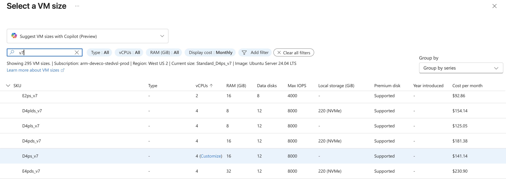
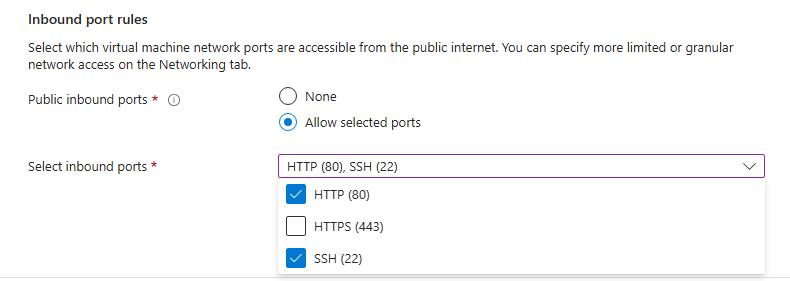
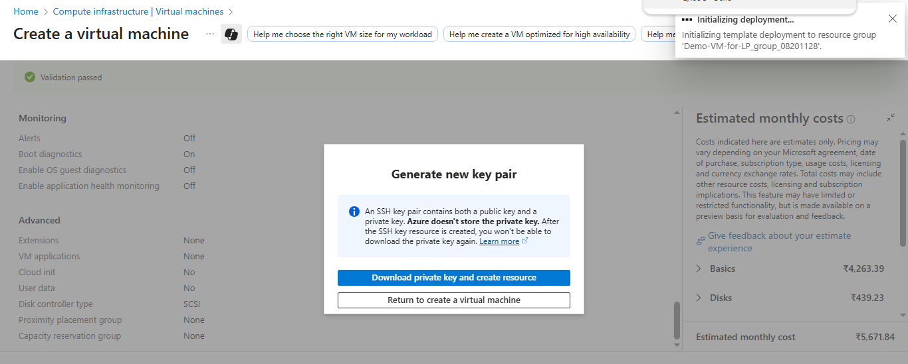

## Prerequisites and setup

There are several common ways to create an Arm-based Cobalt 200 virtual machine, and you can choose the method that best fits your workflow or requirements:

- The Azure Portal
- The Azure CLI
- An infrastructure as code (IaC) tool

In this section, you will launch the Azure Portal to create a virtual machine with the Arm-based Azure Cobalt 200 processor.

Use a general-purpose **Standard_D4ps_v7** VM in the **Dpsv7** series, with 4 vCPUs. See Microsoft’s [Cobalt 200 VM families overview](https://azure.microsoft.com/en-us/blog/new-azure-cobalt-200-vms-deliver-50-performance-improvement-fully-optimized-for-modern-agentic-ai-workloads/) for details.

Your subscription and selected region must have access to Dpsv7 sizes and sufficient vCPU quota. This Learning Path was validated in **West US 2** on **Ubuntu 24.04 LTS (Arm64)**. 

## Create an Arm-based Azure virtual machine

Creating a virtual machine based on Azure Cobalt 200 is no different to creating any other virtual machine in Azure. Follow the steps below to create an Azure virtual machine:

- Launch the Azure portal and navigate to **Virtual Machines**.
- Select **Create**, and select **Virtual Machine** from the drop-down list.
- Inside the **Basic** tab, fill in the instance details such as **Virtual machine name** and **Region**.
- Select the image for your virtual machine (for example, Ubuntu 24.04 LTS) and select **Arm64** as the VM architecture.
- In the **Size** field, select **See all sizes** and select the D-series v7 family of virtual machines.
- Select **D4ps_v7** from the list as shown in the diagram below:



- For **Authentication type**, select **SSH public key**.
- Fill in the **Administrator username** for your VM.
- Select **Generate new key pair**, and select **RSA SSH Format** as the SSH Key Type. 
- Give your SSH key a key pair name.
- In the **Inbound port rules**, select **HTTP (80)** and **SSH (22)** as the inbound ports, as shown below:


- Now select the **Review + Create** tab and review the configuration for your virtual machine.
- When you are happy with your selection, select the **Create** button and then **Download Private key and Create Resource** button.



Your virtual machine should be ready and running in a few minutes. You can SSH into the virtual machine using the private key, along with the public IP details.


{}

To learn more about Arm-based virtual machine in Azure, see “Getting Started with Microsoft Azure” in [Get started with Arm-based cloud instances](/learning-paths/servers-and-cloud-computing/csp/azure/).

{}

Your Azure Cobalt 200 Arm64 virtual machine is now ready. Continue to the next step to install and configure MySQL.

Connect from your local terminal using your VM’s private key, administrator username, and public IP address:

```console
ssh -i <path-to-private-key.pem> <admin-username>@<your-vm-public-ip>
```

After connecting, verify the architecture and CPU model:

```console
uname -m
lscpu | grep 'Model name'
```

The output is similar to:

```output
aarch64
Model name:                              Neoverse-V3
```
