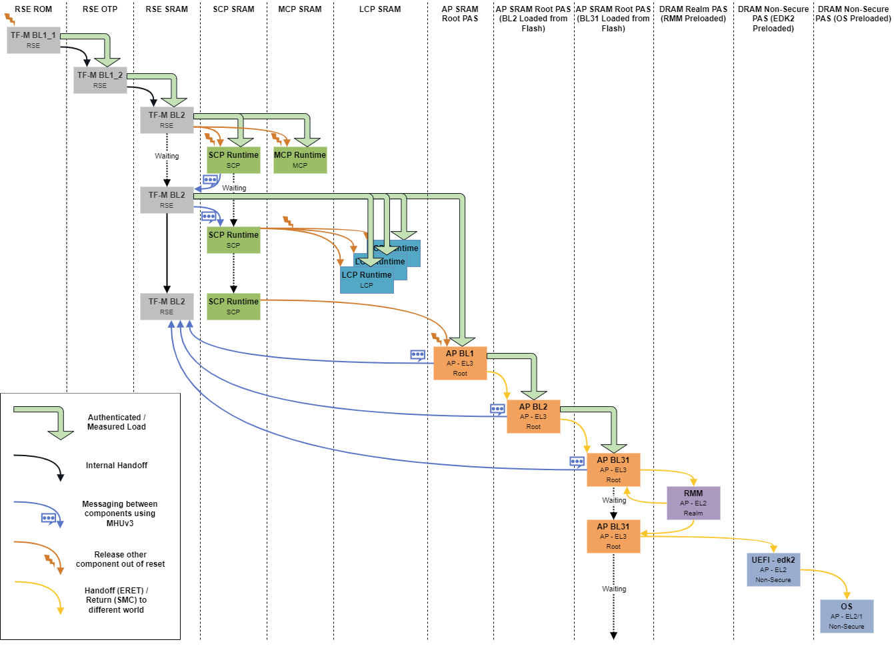

## Firmware stack overview and boot sequence coordination

To ensure the platform transitions securely and reliably from power-on to operating system launch, this section introduces the roles and interactions of each firmware component within the RD-V3 boot process. You’ll learn how each component contributes to system initialization and how control is systematically handed off across the boot chain.

## Booting the system up

In the RD-V3 platform, each firmware component  such as TF-A, RSE, SCP, MCP, LCP, and UEFI operates independently but participates in a well-defined sequence. Each is delivered as a separate firmware image, yet they coordinate tightly through a structured boot flow and inter-processor signaling.

The following diagram from the [Neoverse Reference Design documentation](https://neoverse-reference-design.docs.arm.com/en/latest/shared/boot_flow/rdv3_single_chip.html?highlight=boot) illustrates the progression of component activation from initial reset to OS handoff:

## Stage 1: Security validation starts (RSE)

At platform reset, the Runtime Security Engine (RSE, Cortex-M55) starts executing Trusted Firmware-M (TF-M) boot firmware from RSE ROM while SCP and MCP remain in reset. The RSE boot stages authenticate and load TF-M BL2 (MCUboot), which authenticates and loads the SCP and MCP firmware images and TF-A BL1. RSE records boot measurements and releases SCP and MCP from reset after loading their firmware.

TF-M BL2 runs on RSE and is separate from TF-A BL2, which runs later on the application processor (AP).

***RSE acts as the platform’s security gatekeeper.***

## Stage 2: Early hardware initialization (SCP/MCP)

After TF-M BL2 authenticates and loads their firmware, RSE releases the System Control Processor (SCP, Cortex-M7) and the Manageability Control Processor (MCP, where present) from reset.

They perform essential bring-up:
* Initializing clocks, reset lines, and power domains
* Preparing DRAM and interconnect
* Enabling the application processor (AP) cores and signaling readiness to TF-A

***SCP/MCP are the ground crew bringing hardware systems online.***

## Stage 3: Secure execution setup (TF-A)

When SCP releases the AP from reset, the AP begins executing Trusted Firmware-A (TF-A) BL1 from AP SRAM. TF-A continues the authenticated boot chain on the AP and prepares for handoff to UEFI through BL31, the runtime Root Monitor.

***TF-A is the ignition controller, launching the next stages securely.***

## Stage 4: Firmware and Bootloader (EDK II/GRUB)

TF-A hands off control to UEFI firmware (EDK II), which performs device discovery and launches GRUB.

Responsibilities here include:
* Detecting and initializing memory, PCIe, and boot devices
* Generating ACPI and platform configuration tables
* Locating and launching GRUB from storage or flash

***EDK II and GRUB are like the first- and second-stage rockets launching the payload.***

## Stage 5: Linux kernel boot
 
GRUB loads the Linux kernel and passes full control to the OS.

Responsibilities include:
* Initializing device drivers and kernel subsystems
* Mounting the root filesystem
* Starting user-space processes (for example, BusyBox)

***The Linux kernel is the spacecraft - it takes over and begins its mission.***

## In detail: firmware module responsibilities 
Now that you’ve examined the high-level boot stages, you can now examine each firmware module’s role in more detail.

Each stage of the boot chain is backed by a dedicated component, such as secure bootloader, platform controller, or OS manager, and they work together to ensure reliable system bring-up.

### RSE: Runtime Security Engine (Cortex-M55) (Stage 1: Security Validation)

RSE firmware runs on the Cortex‑M55 and plays a critical role in platform attestation and integrity enforcement.

* Runs TF-M BL2 (MCUboot), which authenticates and loads SCP, MCP, LCP, and TF-A BL1 firmware images
* Records boot measurements and receives measurements from TF-A for platform attestation
* Releases SCP and MCP from reset after their firmware has been authenticated and loaded

RSE starts the platform's chain of trust, which TF-A continues on the AP.

### SCP: System Control Processor (Cortex‑M7) (Stage 2: Early Hardware Bring-up)

* Initializes clocks, reset controllers, and system interconnect
* Manages DRAM setup and enables power for the AP
* Coordinates boot readiness with RSE via the Message Handling Unit (MHU)

### TF-A: Trusted Firmware-A (BL1/BL2/BL31) (Stage 3)

* **BL1** executes from AP SRAM after being authenticated and loaded by TF-M BL2, then authenticates and loads TF-A BL2
* **BL2** authenticates and loads TF-A BL31, the Realm Management Monitor (RMM), and UEFI (BL33)
* **BL31** acts as the runtime Root Monitor, sets up the TF-RMM interface, and triggers RMM initialization. When RMM returns control, BL31 hands off to UEFI (BL33)

SCP and RSE are already running before TF-A BL2 executes. For details of authentication on the AP, see the [RD-V3 chain of trust documentation](https://neoverse-reference-design.docs.arm.com/en/rd-infra-2025.07.03/shared/cot_cca.html).

### UEFI, GRUB, and the Linux kernel (Stages 4–5)

* **UEFI (EDK II):** firmware abstraction, hardware discovery, ACPI table generation  
* **GRUB:** selects and loads the Linux kernel image  
* **Linux kernel:** initializes the OS, drivers, and launches userland (for example, BusyBox)

On the FVP you can see this process through UART logs to validate each stage.

### LCP: Low-Power Controller (optional)

If present, the LCP provides fine-grained platform power management:
* Implements sleep/wake transitions
* Controls per-core power gating
* Manages transitions to ACPI power states (for example, S3, S5)

LCP support depends on the FVP model and can be omitted in simplified setups.

## Coordination and handoff logic

The RD-V3 boot sequence follows a multi-stage, dependency-driven handshake model, where each firmware module validates, powers, or authorizes the next.

| Stage(s) | Dependency chain | Description |
|------:|------------------|-------------|
| 1 | TF-M BL1_1 → BL1_2 → BL2 | RSE starts in ROM and reaches TF-M BL2 (MCUboot) through its boot stages |
| 2 | SCP/MCP ← RSE TF-M BL2 | TF-M BL2 authenticates and loads controller firmware, then releases the controllers from reset |
| 3 | AP ← SCP + RSE | RSE loads TF-A BL1 into AP SRAM; SCP releases the AP to execute TF-A BL1, followed by BL2 and BL31 |
| 4–5 | UEFI → GRUB → Linux | BL31 hands off to UEFI after RMM initialization; UEFI launches GRUB, which loads the kernel |

This handshake ensures no stage proceeds unless its dependencies have securely initialized and authorized the next step.

{}
In the table, arrows (←) indicate **dependency**: the component on the left depends on the component(s) on the right. For example, `SCP/MCP ← RSE TF-M BL2` means the controllers depend on TF-M BL2 running on RSE to load their firmware and release them from reset. The AP depends on RSE loading TF-A BL1 and SCP releasing it from reset.

Right-facing arrows (→) indicate an **execution sequence**, either through the RSE boot stages or from UEFI through GRUB to Linux. TF-M BL2 on RSE and TF-A BL2 on the AP are separate bootloaders.
{}

This layered approach supports modular testing, independent debugging, and early simulation, which is essential for secure and robust platform bring-up.

## Summary

In this section, you have:

* Explored the full boot sequence of the RD-V3 platform, from power-on to Linux login
* Learned about the responsibilities of TF-A, RSE, SCP, MCP, LCP, and UEFI
* Learned how secure boot is enforced and how each module hands off control
* Interpreted boot dependencies using FVP simulation and UART logs

With an understanding of the full boot sequence and firmware responsibilities, you’re ready to apply these insights. In the next section, you’ll fetch the RD-V3 codebase and start building the firmware stack for simulation.
