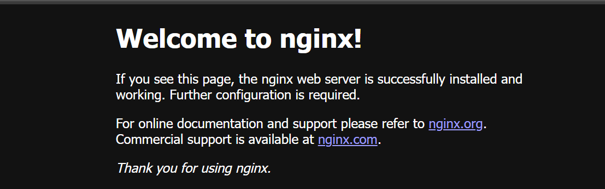

# Install and verify NGINX on Ubuntu 24.04 LTS (Azure Arm64)

In this section, you install and configure NGINX, a high-performance web server and reverse proxy, on your Azure Arm64 (Cobalt 200) virtual machine. NGINX is widely used to serve static content, handle large volumes of connections efficiently, and act as a load balancer. Running it on your Azure Cobalt 200 virtual machine allows you to serve web traffic securely and reliably.

## Install NGINX (apt)

Install NGINX from Ubuntu’s repositories on Ubuntu 24.04 LTS.

Run the following commands to install and enable NGINX:

```console
sudo apt update
sudo apt install -y nginx
sudo systemctl enable nginx
sudo systemctl start nginx
```

## Verify NGINX is running

Check the installed version of NGINX:

```console
nginx -v
```

The output is similar to:

```output
nginx version: nginx/1.24.0 (Ubuntu)
```

{}
The [Arm Ecosystem Dashboard](https://developer.arm.com/ecosystem-dashboard/) recommends NGINX version 1.20.1 or later for Arm platforms.
{}

You can also confirm that NGINX is running correctly by checking its systemd service status:

```console
sudo systemctl status nginx
```

The output is similar to:

```output
● nginx.service - A high performance web server and a reverse proxy server
     Loaded: loaded (/usr/lib/systemd/system/nginx.service; enabled; preset: enabled)
     Active: active (running) since Mon 2026-11-09 17:33:55 UTC; 4min 3s ago
       Docs: man:nginx(8)
   Main PID: 2926 (nginx)
      Tasks: 5 (limit: 17491)
     Memory: 3.8M (peak: 5.2M)
        CPU: 31ms
     CGroup: /system.slice/nginx.service
             ├─2926 "nginx: master process /usr/sbin/nginx -g daemon on; master_process on;"
             ├─2927 "nginx: worker process"
             ├─2928 "nginx: worker process"
             ├─2929 "nginx: worker process"
             └─2930 "nginx: worker process"
```

If you see `Active: active (running)`, NGINX is successfully installed and running.

## Validate HTTP response with curl

You can validate that NGINX is serving HTTP responses using `curl`:

```console
curl -I http://localhost/
```

The **-I** option requests only the HTTP response headers without downloading the page body.

The output is similar to:

```output
HTTP/1.1 200 OK
Server: nginx/1.24.0 (Ubuntu)
Date: Mon, 09 Nov 2026 17:33:43 GMT
Content-Type: text/html
Content-Length: 615
Last-Modified: Mon, 09 Nov 2026 17:33:13 GMT
Connection: keep-alive
ETag: "6af203d9-267"
Accept-Ranges: bytes
```

**Output summary**

| Field            | What it tells you                                   | Example                      |
|------------------|------------------------------------------------------|------------------------------|
| `HTTP/1.1 200 OK`| NGINX responded successfully                        | `HTTP/1.1 200 OK`            |
| Server       | NGINX and version returned by the server            | `nginx/1.24.0 (Ubuntu)`      |
| Content-Type | MIME type of the response                           | `text/html`                  |
| Content-Length | Size of the response body in bytes               | `615`                        |
| Last-Modified| Timestamp of the file served                        | `Mon, 09 Nov 2026 17:33:13 GMT` |
| ETag         | Identifier for the specific version of the resource | `6af203d9-267`             |


This confirms that NGINX is functional at the system level, even before exposing it to external traffic.

## Allow HTTP traffic (port 80) in UFW and NSG

When you created your VM instance earlier, you configured the Azure Network Security Group (NSG) to allow inbound HTTP (port 80) traffic. 

On the VM itself, configure the Ubuntu firewall (UFW) to allow HTTP traffic. Allow SSH before enabling UFW so that you can reconnect to the VM. Run:

```console
sudo ufw allow OpenSSH
sudo ufw allow 80/tcp
sudo ufw enable
```

The output is similar to:

```output
Rules updated
Rules updated (v6)
Command may disrupt existing ssh connections. Proceed with operation (y|n)? y
Firewall is active and enabled on system startup
```

Verify that HTTP is allowed with:

```console
sudo ufw status
```

The output is similar to:

```output
Status: active

To                         Action      From
--                         ------      ----
OpenSSH                    ALLOW       Anywhere
80/tcp                     ALLOW       Anywhere
OpenSSH (v6)               ALLOW       Anywhere (v6)
80/tcp (v6)                ALLOW       Anywhere (v6)
```

This ensures that both Azure and the VM-level firewalls permit HTTP requests.

## Access the NGINX welcome page

Find your VM’s **Public IP address** in the Azure portal and open the following URL in your browser, replacing the placeholder:

```text
http://<your-vm-public-ip>/
```

You should see the default NGINX welcome page as shown below, which confirms that HTTP traffic is reaching your VM:



At this stage, your NGINX installation is complete. You are ready to begin baseline testing and further configuration.
