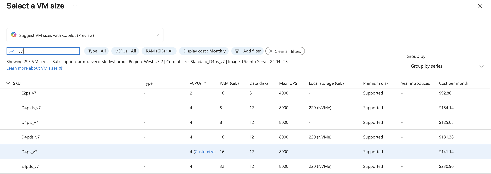
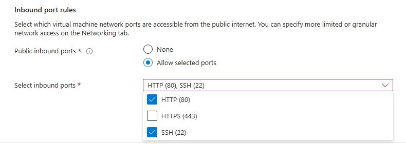
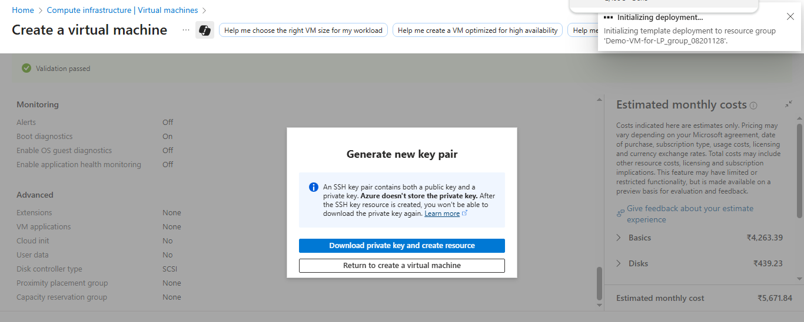

## Set up your development environment

There is more than one way to create an Arm-based Cobalt 200 virtual machine:

- The Microsoft Azure portal
- The Azure CLI
- Your preferred infrastructure as code (IaC) tool

In this Learning Path, you will use the Azure portal to create a virtual machine with the Arm-based Azure Cobalt 200 processor.

You will use a general-purpose **Standard_D4ps_v7** VM in the **Dpsv7** series, with 4 vCPUs. See Microsoft’s [Cobalt 200 VM families overview](https://azure.microsoft.com/en-us/blog/new-azure-cobalt-200-vms-deliver-50-performance-improvement-fully-optimized-for-modern-agentic-ai-workloads/) for details.

Your subscription and selected region must have access to Dpsv7 sizes and sufficient vCPU quota. The VM used to validate this Learning Path was deployed in **West US 2**. Availability can vary by subscription and region.

## Create an Arm-based Azure virtual machine

Creating a virtual machine based on Azure Cobalt 200 is similar to creating any other virtual machine on Azure.

To get started, launch the Azure portal and navigate to **Virtual Machines**. Then follow these steps:

- Select **Create**, then select **Virtual machine** from the drop-down list.
- In the **Basics** tab, fill in information about the instance such as **Virtual machine name** and **Region**.
- Select the image for your virtual machine (for example, Ubuntu 24.04 LTS) and select **Arm64** as the VM architecture.
- In the **Size** field, select **See all sizes**, select the **D-series v7** family of virtual machines, then select **D4ps_v7**.



- Now select **SSH public key** as the authentication type. Azure can generate an SSH key pair for you and store it for future use. It is a fast, simple, and secure way to connect to your virtual machine.
- Enter the **Administrator username** for your VM.
- Select **Generate new key pair**, then select **RSA SSH format** as the SSH key type. RSA can offer better security with keys longer than 3072 bits. 
- Give a **Key pair name** to your SSH key.
- In **Inbound port rules**, select **HTTP (80)** and **SSH (22)** as the inbound ports. The default port for NGINX when handling standard web traffic (HTTP) is 80.



Now select the **Review and create** tab and review the configuration for your virtual machine.

When you have made your selection, select **Create**, then **Download private key and create resources**.



Your virtual machine should soon be ready and start running. You can SSH into the virtual machine using the private key and the **Public IP** details.

{} To find out more about Arm-based virtual machines on Azure, see the section *Getting Started with Microsoft Azure* within the Learning Path [Get started with Arm-based cloud instances](/learning-paths/servers-and-cloud-computing/csp/azure/). {}

For example, connect from your local terminal using the username, private key, and public IP address for your VM:

```console
ssh -i <path-to-private-key.pem> <admin-username>@<your-vm-public-ip>
```

After connecting, verify the architecture and CPU model:

```console
uname -m
lscpu | grep 'Model name'
```

The output is similar to:

```output
aarch64
Model name:                              Neoverse-V3
```
