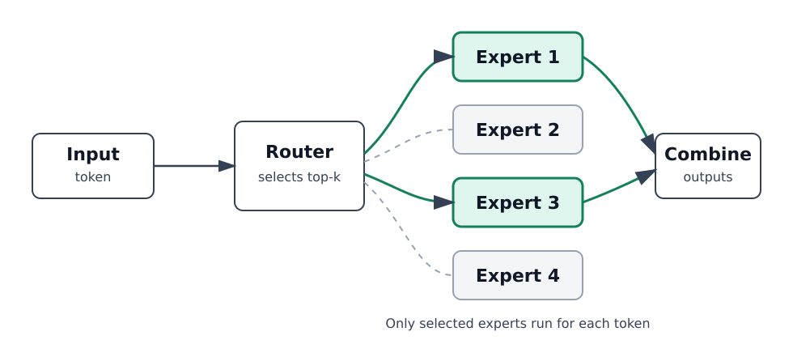

## What is vLLM?

[vLLM](https://docs.vllm.ai/en/latest/) is an open-source, high-throughput inference and serving engine for large language models. It provides an OpenAI-compatible API server and benchmarking tools for measuring online serving performance.

You will serve Mixture of Experts (MoE) models on Arm CPUs, validate responses, and measure serving throughput and latency.

## Understand MoE models

MoE layers contain multiple expert networks. For each token, a router selects a subset of those experts.

The following diagram shows the high-level routing flow for an MoE layer:



This can reduce compute compared with activating the full model, but it also makes inference performance depend heavily on routing, batching, and optimized expert kernels.

This Learning Path focuses on two MoE paths:

- BF16 (16-bit floating-point) MoE inference and benchmarking
- INT8/W8A8 (8-bit weights and activations) MoE inference and benchmarking

## Understand the models you'll use

The instructions let you run and benchmark MoE models with vLLM 0.31.0 on your Arm server. The results section also presents the historical before-and-after measurements for the optimized AArch64 MoE path. The optimized path enables the CPU FusedMoE kernel on Arm CPUs and accelerates the BF16 expert GEMMs used inside MoE layers.

[Gemma 4 26B-A4B](https://huggingface.co/google/gemma-4-26B-A4B-it) is a multimodal MoE model. You will use its text-generation capability in BF16.

[GPT-OSS 20B BF16](https://huggingface.co/unsloth/gpt-oss-20b-BF16) provides a second MoE model family for the BF16 comparison.

[Qwen3-30B-A3B-Thinking-2507](https://huggingface.co/Qwen/Qwen3-30B-A3B-Thinking-2507) provides the BF16 reference for the quantization comparison.

[Red Hat AI’s W8A8 Qwen3 checkpoint](https://huggingface.co/RedHatAI/Qwen3-30B-A3B-Thinking-2507-quantized.w8a8) provides the pre-quantized model for INT8 inference.

## Set up your environment

Before you begin, make sure your environment meets these requirements:

- Python 3.12 on Ubuntu 24.04 LTS
- An Arm-based Linux server running Ubuntu 24.04 LTS, with enough CPU cores, memory, and disk space for large MoE models

The benchmark results in this Learning Path were collected on a 96-core Arm Neoverse-V2 system with 185 GiB RAM and a 484 GB root volume.

Allow RAM for all model weights, the KV cache, and runtime buffers. MoE routing reduces the number of experts used per token, but all expert weights still need to be loaded. Allow disk space for the model downloads retained in the Hugging Face cache. The benchmark hardware is a reference configuration, not a verified minimum.

## Check CPU instruction support

On your Arm Linux server, check the architecture and CPU features before installing vLLM:

```bash
uname -m
lscpu
```

The architecture should be `aarch64`. In the `Flags` line from `lscpu`, look for `bf16` and `i8mm`. You can also check these flags directly:

```bash
for feature in bf16 i8mm; do
  if grep -qw "$feature" /proc/cpuinfo; then
    echo "$feature: available"
  else
    echo "$feature: not exposed by this system"
  fi
done
```

The expected output on a system that exposes both features is:

```output
bf16: available
i8mm: available
```

The flags identify the instructions used by the optimized paths:

- `bf16` indicates support for the Arm BF16 instructions used by the optimized BF16 MoE path, including BFMMLA.
- `i8mm` indicates support for INT8 matrix-multiply instructions, including SMMLA, used by the optimized INT8/W8A8 MoE path.

W8A8 is a quantization format, so there is no CPU flag named `w8a8`. These checks confirm instruction availability; running the models later in this Learning Path verifies that your vLLM build and model configuration work together.


## Install Dependencies

Install the following packages required for running vLLM on Arm. PyTorch's Inductor backend needs `g++` to compile CPU code during model warmup, even when you install vLLM from a prebuilt wheel. The `curl` and `wget` tools are used for API requests and downloads:

```bash
sudo apt-get update -y
sudo apt install -y python3.12-venv python3.12-dev g++ curl wget
```

## Create and activate a Python virtual environment

Install vLLM inside an isolated environment to prevent conflicts between system and project dependencies:

```bash
python3.12 -m venv vllm_env_new
source vllm_env_new/bin/activate
python -m pip install --upgrade pip
```

## Install vLLM for CPU

{}
Use vLLM 0.31.0 for this Learning Path. This version was validated with Gemma 4, GPT-OSS, Qwen3 BF16, and Qwen3 W8A8 on Arm CPUs. The command installs the CPU-specific vLLM wheel used for the benchmark validation. For other versions, see the [vLLM releases page](https://github.com/vllm-project/vllm/releases).
{}

Install a CPU-specific build of vLLM:

```bash
export VLLM_VERSION=0.31.0
python -m pip install "https://github.com/vllm-project/vllm/releases/download/v${VLLM_VERSION}/vllm-${VLLM_VERSION}%2Bcpu-cp38-abi3-manylinux_2_39_aarch64.whl" --extra-index-url https://download.pytorch.org/whl/cpu
```

If you want to build vLLM from source, follow the instructions in the [Build and Run vLLM on Arm Servers Learning Path](/learning-paths/servers-and-cloud-computing/vllm/vllm-setup/).

## Verify package versions

With your virtual environment active, check the installed package versions:

```bash
python -c "from importlib.metadata import version; print('vLLM:', version('vllm'))"
python -c "from importlib.metadata import version; print('torch:', version('torch'))"
python -c "from importlib.metadata import version; print('transformers:', version('transformers'))"
```

The expected output for the package versions used in the public-wheel validation is:

```output
vLLM: 0.31.0+cpu
torch: 2.13.0+cpu
transformers: 5.17.0
```

## Configure vLLM KV cache space

The key-value (KV) cache stores attention state for tokens already processed. In the terminal where you will start the server, set the cache budget used for the reported benchmarks:

```bash
export VLLM_CPU_KVCACHE_SPACE=64
```

The value is in GiB. This 64 GiB budget is additional to model weights and runtime memory. You can adjust this value based on available RAM, model size, context length, and expected concurrency.

## What you've accomplished and what's next

You've now set up your environment to run BF16 and INT8/W8A8 MoE inference with vLLM.

Next, you'll review the MoE precision choices and then use vLLM to run inference.
