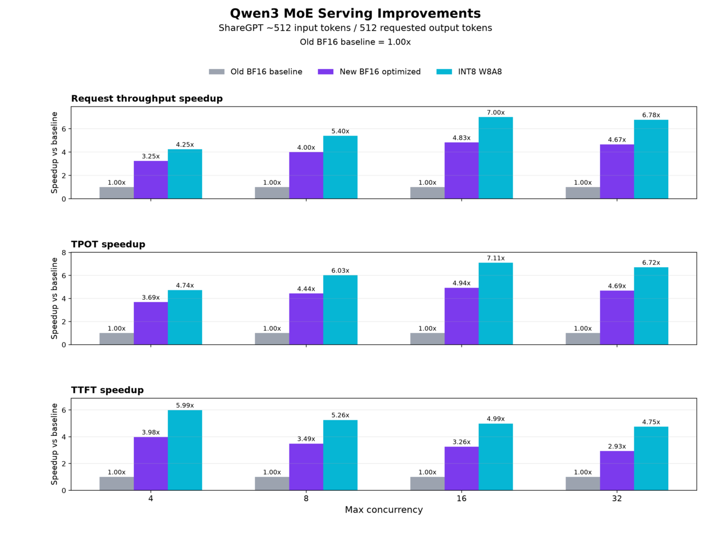

## Interpret the reported results

The ShareGPT ~512 input-token benchmarks focus on serving performance only. They compare the following metrics across BF16 and INT8/W8A8 runs:

- Request throughput
- Output token throughput
- Time to first token (TTFT)
- Time per output token (TPOT)

Model quality and accuracy weren't evaluated in this benchmark pass.

The benchmark requested 512 output tokens and used `vllm bench serve`.

Throughput speedup is optimized throughput divided by baseline throughput. A `3.25x` speedup means a 225% increase. Latency reduction is `(baseline latency - optimized latency) / baseline latency × 100%`. In the Qwen3 plot, latency speedup instead means baseline latency divided by optimized latency. Compare matching concurrency values and workloads.

{}
Your measurements can vary with hardware, package versions, server settings, and system load.
{}

### Gemma 4 BF16 MoE

Gemma 4 was benchmarked with ShareGPT ~512 input-token prompt subsets.

The reported optimized BF16 mixture of experts (MoE) runs improve Gemma 4 request throughput by around `3.25x` to `3.80x`, depending on concurrency.

| Prompt subset | Requests per second speedup | Output tokens per second speedup | Mean TPOT reduction |
| --- | ---: | ---: | ---: |
| ShareGPT ~512 input tokens | 3.25x - 3.80x | 3.15x - 3.83x | 68% - 74% |

These ratios describe the reported configuration; they are not a performance guarantee for other Arm servers.

### GPT-OSS BF16 MoE

GPT-OSS was benchmarked with ShareGPT ~512 input-token prompt subsets.

The reported optimized BF16 MoE runs improve GPT-OSS request throughput by around `2.80x` to `3.62x`, depending on concurrency.

| Prompt subset | Requests per second speedup | Output tokens per second speedup | Mean TPOT reduction |
| --- | ---: | ---: | ---: |
| ShareGPT ~512 input tokens | 2.80x - 3.62x | 2.74x - 3.50x | 64% - 72% |

### Qwen3 BF16 and INT8/W8A8 MoE

The Qwen3 comparison uses pre-optimization BF16 as the baseline. 

The comparison includes the pre-optimization Qwen BF16 baseline, new optimized Qwen BF16, and new Qwen INT8/W8A8.

The following ratios compare request throughput:

| Prompt subset | New BF16 versus pre-optimization BF16 | INT8/W8A8 verus pre-optimization BF16 | INT8/W8A8 versus new BF16 |
| --- | ---: | ---: | ---: |
| ShareGPT ~512 input tokens | 3.25x - 4.83x | 4.25x - 7.00x | 1.31x - 1.45x |

Mean TPOT is also lower with INT8/W8A8 than with optimized BF16.

The reported measurements indicate two improvements:

- BF16 MoE optimization improves regular BF16 MoE models.
- INT8/W8A8 MoE support provides an additional optimized path compared with BF16.

## What you've accomplished

You've now reviewed the benchmark results for BF16 and INT8/W8A8 MoE inference with vLLM on Arm CPUs.

Use the same workload, package versions, server settings, and concurrency values when comparing your results.
