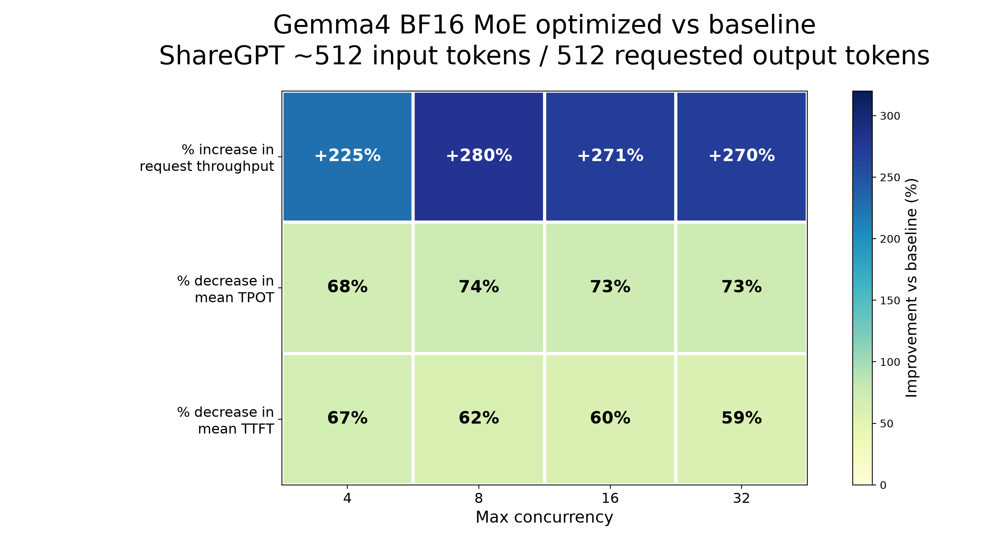
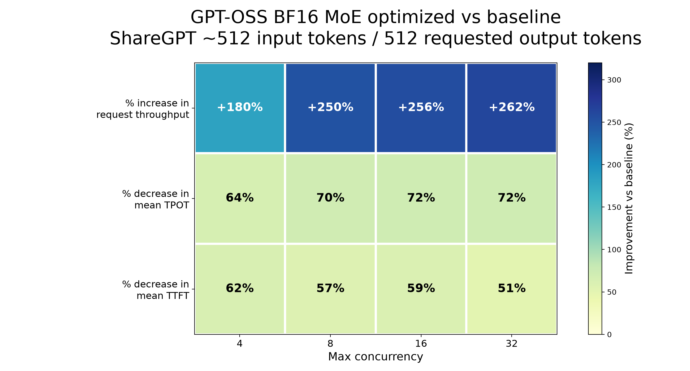

## Interpret the reported results

{}
These author-reported measurements are retained for review while benchmark validation is pending. Reproduction requires the missing prompt subsets, exact baseline and optimized build configurations, and raw result files. The current instructions install only the optimized release.
{}

These benchmarks focus on serving performance only. They compare request throughput, output token throughput, TTFT, and TPOT across BF16 and INT8/W8A8 runs.

Model quality and accuracy are out of scope for this Learning Path and were not evaluated in this benchmark pass.

This section summarizes the ShareGPT ~512 input-token benchmark results. The benchmark requested 512 output tokens and used `vllm bench serve`.

Throughput speedup is optimized throughput divided by baseline throughput. A `3.25x` speedup means a 225% increase. Latency reduction is `(baseline latency - optimized latency) / baseline latency × 100%`. In the Qwen3 plot, latency speedup instead means baseline latency divided by optimized latency. Compare matching concurrency values and workloads.

## Gemma 4 BF16 MoE

Gemma 4 was benchmarked with ShareGPT ~512 input-token prompt subsets.

The reported optimized BF16 MoE runs improve Gemma 4 request throughput by around `3.25x` to `3.80x`, depending on concurrency.

| Prompt subset | Req/s speedup | Output tok/s speedup | Mean TPOT reduction |
| --- | ---: | ---: | ---: |
| ShareGPT ~512 input tokens | 3.25x - 3.80x | 3.15x - 3.83x | 68% - 74% |

These ratios describe the reported configuration; they are not a performance guarantee for other Arm servers.

## GPT-OSS BF16 MoE

GPT-OSS was benchmarked with ShareGPT ~512 input-token prompt subsets.

The reported optimized BF16 MoE runs improve GPT-OSS request throughput by around `2.80x` to `3.62x`, depending on concurrency.

| Prompt subset | Req/s speedup | Output tok/s speedup | Mean TPOT reduction |
| --- | ---: | ---: | ---: |
| ShareGPT ~512 input tokens | 2.80x - 3.62x | 2.74x - 3.50x | 64% - 72% |

In the tested vLLM 0.27.1+cpu setup, GPT-OSS required local Harmony/tiktoken encoding files during serving and benchmarking.

## Qwen3 BF16 and INT8/W8A8 MoE

The Qwen3 comparison uses pre-optimization BF16 as the baseline. The comparison includes:

- Pre-optimization Qwen BF16 baseline
- New optimized Qwen BF16
- New Qwen INT8/W8A8

The following ratios compare request throughput:

| Prompt subset | New BF16 vs pre-optimization BF16 | INT8/W8A8 vs pre-optimization BF16 | INT8/W8A8 vs new BF16 |
| --- | ---: | ---: | ---: |
| ShareGPT ~512 input tokens | 3.25x - 4.83x | 4.25x - 7.00x | 1.31x - 1.45x |

Mean TPOT is also lower with INT8/W8A8 than with optimized BF16.

The reported measurements indicate two improvements:

- BF16 MoE optimization improves regular BF16 MoE models.
- INT8/W8A8 MoE support provides an additional optimized path compared with BF16.

## Plots

The following plots show relative speedups for the ShareGPT ~512 input-token subset with 512 requested output tokens.

### Gemma 4 BF16 before and after optimization

### GPT-OSS BF16 before and after optimization

### Qwen3 BF16 and INT8/W8A8 comparison

## What you've accomplished

You've now reviewed the benchmark results for BF16 and INT8/W8A8 MoE inference with vLLM on Arm CPUs.

Use the same workload and concurrency when comparing your results. Full reproduction of these ratios remains pending until the benchmark inputs and baseline configuration are supplied.
